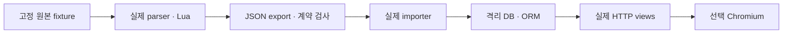
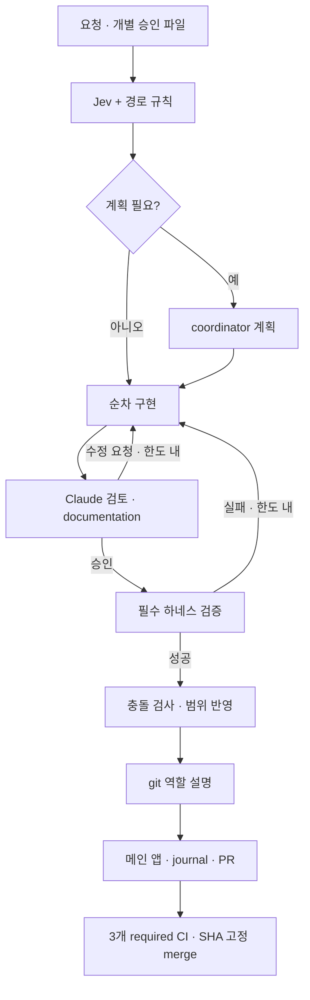

# 전체 하네스 설계

기록일: 2026-10-11. Codex 경고·성공 판정 갱신: 2026-10-12. 이 문서는 현재 소스의 설계와 검토 기준을 Git에 남긴다.
명령·설치 절차는 [하네스 사용법](harness.md), [자동 작업 실행](workflow.md),
[모델 연결](agent-models.md), [접수 판단](triage.md), [대화 압축](compaction.md)에 둔다.
서비스의 데이터 책임은 [프로젝트 지도](architecture.md), 계약은 [데이터 계약](data-contracts.md),
주요 결정과 대체 이력은 [ADR](adr/README.md)에서 관리한다.
이 문서의 검증 설명은 소스에 정의된 경로와 게이트이며 특정 실행의 성공 기록이 아니다.

## 목표와 비목표

목표는 운영 상태를 건드리지 않고 작은 재현 가능한 입력으로 실제 로직과 경계를 검증하고,
개발 요청을 명시적 파일 범위 안에서 배정·구현·검토·검증·반영·게시하는 것이다.
검토 판단, 필수 검증의 coverage, 실패와 대기 상태를 구분하여 기계가 읽을 수 있는 결과를 남긴다.
현재 코드 설명뿐 아니라 선택 이유·비용·한계를 설계서와 ADR로 유지한다.

전체 게임 데이터·모든 Lua 수식·모든 지역 화면의 정확성을 보증하거나 운영 DB를 보정하는 것은
목표가 아니다. cron·전체 다운로더·운영 importAll·배포는 개발 흐름의 부수 단계가 아니다.
모델 작업 사본은 일반 목적 VM 보안 경계가 아니며, 모든 공급자의 월 비용 통합 집계나 자동
Opus escalation·다른 유료 공급자 전환도 제공하지 않는다. 기본 검사의 성공을 선택 검사나
실사이트 정상 동작의 증거로 바꾸지 않는다.

## 구성과 책임

| 구성 | 책임 | 실제 진입점 |
| --- | --- | --- |
| 메인 Codex `/root` | 요청·개별 읽기 범위 준비, 부족 범위 확인, 앱 요청 실행과 최종 결과 보고 | [AGENTS.md](../AGENTS.md), [workflow 사용법](workflow.md) |
| 접수 판단 | 경로 규칙에 Jev 영역·복잡도·계약 영향 추가, 보수적 fallback | [triage.py](../harness/triage.py), [triage-config.json](../harness/triage-config.json) |
| 실행기 | 두 사본 생성, 순차 역할 실행, schema·수정 한도·검토·필수 검사·반영 게이트 | [workflow.py](../harness/workflow.py), [workflow-config.json](../harness/workflow-config.json) |
| 모델 연결 | 역할별 CLI·인증·파일 도구·예산·환경 분리, 고정 압축 연결 | [agent_models.py](../harness/agent_models.py), [agent-models.json](../harness/agent-models.json), [compaction.py](../harness/compaction.py) |
| 작업 사본 | 승인 소스 복사, 로컬 검증 사본, 범위 동기화·hash 충돌 검사·백업·교체 | [workspace.py](../harness/workspace.py) |
| 검증 실행 | 새 프로세스·임시 파일·실제 Django 테스트 DB/migrations, 구조화된 coverage | [runner.py](../harness/runner.py), [django_runner.py](../harness/django_runner.py), [Makefile](../Makefile) |
| 실패 피드백 | 로컬 실패 위치를 승인 소스에 귀속하고 안전한 제한 진단만 재수정에 전달 | [failure_feedback.py](../harness/failure_feedback.py) |
| GitHub 게시 | 모델 설명과 별개로 journal·정책·SHA·앱 응답·CI·merge 결과 검사 | [git_publish.py](../harness/git_publish.py), [git-publish-config.json](../harness/git-publish-config.json) |
| CI | 오프라인·MySQL·Chromium을 각 작업에서 실행하고 산출물 보관 | [harness.yml](../.github/workflows/harness.yml) |

다운로더는 수집·압축 해제·번역 준비, 파서는 형식 해석·게임 값·JSON export,
importer는 비교·ID 정규화·DB 적재, Django는 ORM·HTTP 서빙을 담당한다.
그 책임을 하네스가 대신 구현하지 않고 실제 경로를 테스트에 연결한다.

## 고정 입력과 실제 검증 경로

`runner.py`는 그룹별 새 프로세스와 `HARNESS_WORK_DIR` 임시 디렉터리를 사용한다.
기본 설정은 `TavernofSoul/TavernofSoul/settings_harness.py`이며 SQLite `:memory:`와 임시 JSON을
사용한다. 기존 `settings_test.py`는 운영 MySQL·JSON을 참조할 수 있으므로 격리 설정으로 사용하지 않는다.
`django_runner.py`는 실제 DiscoverRunner의 테스트 DB·migrations 수명주기를 사용한다.

기본 `check`는 downloader·parser·Django 회귀와 pipeline을 모두 실행한다. parser 그룹은
`parser_tidy/tests/test_*.py`의 선택 범위와 `harness/test_*.py`를 포함하므로 workflow 회귀도
기본 게이트에 들어간다. pipeline 그룹은 `harness.tests`, `combat_tests`, `contract_tests`,
`world_tests`, `regional_tests`, `equipment_tests`를 실제 Django runner에 연결한다.
아이템·스킬·몬스터·드롭·맵·속성·버프·지역별 장비·카드·컬렉션·젬 원본 fixture는 실제 파싱,
Lua 계산, export, importer·ORM·검색/상세 HTTP로 연결한다. 유형별로 JSON까지만 검사하거나
별도 고정 JSON을 계약 입력으로 사용하는 coverage도 있으며 [사용법의 상세 범위](harness.md)에 구분한다.
일부 sample 통과를 전체 main.py·binary IES 해제·운영 계산식 검증으로 해석하지 않는다.

다운로더 테스트는 인터넷을 차단하고 고정 urllib 응답을 공급한다. 다운로드 저장·PAK 해제·번역
복사·버전 기록은 실제 Python 로직이며 네이티브 IPF는 stub으로 호출 순서·오류 처리를 검사한다.
이는 외부 서버 가용성·실제 복호화/IES 변환 정확성의 증명이 아니다.
parser/export 실패의 공개 JSON·버전 보존, importer 적재 실패의 DB·Version·prev 보존과 재시도는
각 경계 검증의 목적이다. 운영 디렉터리 전체에 대한 원자 롤백을 주장하지 않는다.

검사 종료 코드 0만으로 성공 처리하지 않는다. 선택 테스트 0개, skip/xfail, 구조화된 failures/errors,
누락·잘못된 보고서와 비정상 프로세스 종료는 실패다. 이전 보고서를 제거해 과거 성공이 crash를
덮지 못하게 한다. `runner.py`의 EXCLUDED에 명시한 기존 local baseline 및 kTOS unpack 의존
테스트만 기본 범위에서 제외하며 제외 사유·deselect를 기록한다. 제외 범위를 성공 근거에 포함하지 않는다.

## 기본 경로와 선택 환경의 경계

| 환경 | 입력·격리·검증 | 기본/CI와의 관계 |
| --- | --- | --- |
| SQLite | 합성 고정 입력, 메모리 DB, 임시 JSON, 실제 migrations·ORM·HTTP | 로컬 기본 `check` |
| MySQL | 명시적 테스트 접속과 제한 계정, `settings_harness_mysql.py`, 같은 통합 그룹과 MySQL 전용 검사 | 별도 `check-mysql`; CI `MySQL harness` |
| Chromium | fixture를 적재한 임시 Django 서버와 실제 브라우저, 엔진 보고서까지 요구 | 별도 `check-browser`; CI `Chromium browser harness` |
| live | 검토된 작은 iTOS/kTOS 원본 snapshot의 hash/revision, parser→SQLite→views | 별도 `check-live`; CI 오프라인 작업에서 기본 check 뒤 실행 |
| site | 설정된 iTOS/kTOS 공개 HTTPS에 GET/HEAD smoke | 별도 `check-site`; merge 필수 CI 밖 |

[mysql.sh](../harness/mysql.sh)는 digest 고정 MySQL 8.4의 일회용 컨테이너·임시 저장소를
생성·정리한다. [browser.sh](../harness/browser.sh)는 Chromium 엔진만 컨테이너에서 실행하며
운영 DB·JSON·소스·인증을 mount하지 않는다. 브라우저 SDK만 읽기 전용 mount한다.
설치·Docker·외부 site 요청은 선택 경로의 명시적 운영 준비/실행이지 기본 오프라인 검사 부작용이 아니다.
CI는 현재 Ubuntu 22.04·Python 3.8·Node 22를 사용하고 의존성/브라우저 설치 뒤 검사한다.
따라서 오프라인이라는 말은 고정 입력 검증의 데이터 경계를 뜻하며 CI 환경 설치까지 무통신이라는 뜻은 아니다.

## 개발 요청에서 GitHub 완료까지

메인은 요청과 외부 모델이 읽을 소스·테스트·문서·예정 신규 파일의 개별 경로를 준비한다.
실행기는 준비 검사 doctor를 먼저 수행하고 Jev를 관측한다. 경로 규칙이 최소 필수 검사를 결정하며
Jev는 이를 낮추지 못한다. Jev 영역과 경로가 일치하는 명확한 작업은 직접 담당자에 배정한다.
여러 영역·불확실성·계약 영향·키 누락·응답/전송 실패는 coordinator 계획과 전체 check로 간다.
triage 단독 명령은 shadow 기록이며 `execution_allowed=false`다. 실제 실행 주체는 workflow다.

계획 JSON은 정확히 `tasks`; 각 task는 `role/task/files`이며 승인 파일을 정확히 한 번씩
소유 역할에 배정한다. 공통 하네스·문서는 coordinator, downloader/parser_tidy/TavernofSoul은
각 담당자이며 `workflow.owner()`의 세 parser_tidy Django 회귀 파일은 django에 배정한다.
작업은 계획 순서대로 실행한다. 계획 schema는 파일 배정만 검사하며 문서 필요 여부의 의미 판단은
지침과 reviewer의 책임이다. 읽기 전용 참조도 승인 파일 배정에 포함하되 task 설명으로 편집 대상과 구분한다.

구현 후 모델 사본의 승인 변경만 검증 사본에 동기화하고 diff·실제 변경 목록으로 Claude 검토를 받는다.
검토 승인 뒤 경로·Jev·소유 역할의 필수 검사를 모두 실행한다. 모든 검사가 통과하고 검사 자체의
소스 변경이 없어야 원본 충돌 검사를 거쳐 반영한다. read_only·demo는 원본 반영하지 않는다.
기본 쓰기·변경 있음·게시 활성 상태에서는 git 역할이 설명 JSON만 반환하고 메인 앱에 넘긴다.

## 역할 모델과 압축

현재 [역할 설정](../harness/agent-models.json)의 연결은 다음과 같다. 모델·예산을 문서화 때문에 바꾸지 않는다.

| 역할 | provider / model | effort · 호출 예산 |
| --- | --- | --- |
| coordinator / parser | codex / gpt-6.1-sol | high |
| django / git | codex / gpt-6.1-sol | medium |
| downloader | zai / glm-5.3-flash | CLI 설정에 effort·달러 예산 없음 |
| reviewer | claude / claude-sonnet-5-5 | medium · 호출별 2 USD |
| escalation | claude / claude-opus-5-5 | high · 호출별 5 USD; workflow 자동 호출 없음 |
| 접수 Jev | typesafe / jev-1.13.0 | timeout 8초; 오류 시 자동 API 재시도 없음 |

Codex는 ChatGPT 로그인, Claude/Z.ai는 분리한 API 인증·런타임을 사용한다.
Claude Code의 downloader/reviewer/escalation은 설정상 고정 압축 플러그인을 사용한다.
[compaction.py](../harness/compaction.py)는 실행 전 vendor의 source/compiled hash를 검사하며
자동 다운로드·업데이트하지 않는다. [압축 문서](compaction.md)에 기록된 upstream pin은
`e3f262a7f4d42bd8dd32ced30d26176f7cb545b0`, 모델은 `jev-1.13.0`이다.
오류·키 누락·입력 초과·효과 부족에서는 Claude 기본 압축에 맡긴다.
대화 텍스트·도구 입력이 TypeSafe로 전송되고 도구 결과는 크기/오류 메모로 바뀐다.
별도 TypeSafe 사용량은 Claude 달러 한도에 합산되지 않는다. `compaction.status=requested`는
로드 요청이며 성공 증명이 아니다. CLI 훅 거부와 모델 응답 성공도 별도로 보고한다.

### Codex 경고와 성공 판정

2026-10-12의 [ADR 0007](adr/0007-codex-warning-success-boundary.md)은 stdout/stderr 경고 분류보다
성공 증거를 우선 검증한다. 인증은 exit0와 정확한 ChatGPT 로그인 상태를 요구하고 API 키 인증을 거부한다.
역할 실행은 exit0·엄격한 JSON event 파싱·유효 최종 agent_message·turn.completed·failed/error event 없음,
smoke는 nonce 일치까지 요구한다. 생성·정리 실패와 timeout도 실패이며 성공을 보고하지 않는다.
PATH aliases 읽기 전용 warning 단독은 이 조건을 통과한 ready/passed를 실패로 만들지 않는다.
경고가 있어도 nonzero, 실패 event, malformed/미완료/빈 응답, 인증 실패나 nonce 불일치는 실패다.

private 보고서의 `warnings`는 고정 `stage/category` 목록만 보존한다. 현재 category는
`path_aliases_read_only`, stage는 `authentication`/`execution`이다. 인증 경고를 역할 실행까지 전달하며
stderr 원문·경로·인증은 저장하지 않는다. nonzero 실패 진단의 같은 category는 실패 분류일 뿐이고,
warning은 실패를 성공으로 바꾸거나 권한 확대·fallback·재시도를 허용하는 증거가 아니다.
검증 실패 응답은 저장하지 않고 신뢰된 최종 응답만 기존 private 보고서에 남긴다.
`workflow.model_step`은 결과 전체를 agents에 보존한 뒤 passed 및 scope를 확인하며 이후 새 Claude 검토·
필수 검사·충돌 검사·반영·Git/게시 게이트를 유지한다. 모델 passed는 전체 workflow 완료를 뜻하지 않는다.

메인 조사 요약에서 이전 일반 실행의 exit0 편집은 stderr 선판정으로 반영되지 않았다.
CLI 0.161.0 무추론 비교는 writable private runtime에서 exit0/경고 없음, `CODEX_HOME=/sys`와
나머지 private 경로 조합에서 exit0/경고 있음을 관측했다. 별도 draft 복구는 일반 경로 수리 검증이 아니다.
최초 경고 발생 하위 프로세스는 raw stderr 미보존으로 미확정이며 runtime deny가 하위 초기화 warning을
유발할 가능성은 추론이다. [공식 sandbox 문서](https://learn.chatgpt.com/docs/sandboxing)는 spawned commands에도
적용되는 일반 경계의 참고이며 PATH aliases 구현을 증명하지 않는다. 상세 사실과 한계는
[모델 연결](agent-models.md#실패-진단-읽기)에 둔다. [ADR 0002](adr/0002-explicit-model-read-scope.md)의
격리 결정을 유지한다. root0700/auth0600·runtime deny·root deny/minimal read·좁은 source/CLI/셸 예외·
network=false·모델/역할/예산은 변경하지 않는다.

오프라인 회귀 명세와 실제 관측은 구분한다. 수리 worker는 검사를 실행하지 않았다. 문서 의미 판단은
새 Claude 검토가 맡고 full make check·일반 Codex 도구 편집 실호출·Git 역할·GitHub PR/CI/merge는
메인/orchestrator가 수행해야 한다. private 로그 원문을 설계 문서로 옮기지 않는다.

## 실패 복구와 필수 게이트

[workflow-config.json](../harness/workflow-config.json)의 현재 한도는 max_tasks=8,
max_plan_attempts=2, max_rounds=2, 모델 timeout=900초, 검사 timeout=1800초다.
파일 32 MiB·snapshot 128 MiB·diff 512 KiB를 넘으면 자르지 않고 실패한다.
계획 JSON 문법/schema만 고정 진단으로 한도 내 새 계획을 요청한다. scope/소유권 위반,
planner 쓰기·CLI 실패는 복구 대상이 아니며 잘못된 모델 원문·임의 예외를 다시 보내지 않는다.

검토 수정 요청과 검사 실패는 원래 task의 정확한 파일에 귀속한다. 필터는 실패 위치를
승인 소스에서 확인하고 명령·고정 분류·허용 예외 타입·줄 번호·최대 7줄의 짧은 소스만 전달한다.
private 로그 원문·런타임 값·매개변수 test ID·임의 오류 메시지는 전달하지 않는다.
위치/문맥을 확인할 수 없으면 unavailable/unattributed로 표시하고 남은 라운드에서 최초 task
전체에 원인 없는 제한 메타데이터만 전달한다. 부족 문맥은 메인이 조사해 범위를 확인한다.
이 필터는 키 치환과 별개이며 원인을 확정하는 기능이 아니다.

수정 후 항상 새 reviewer 검토와 최초 필수 검사 전체를 다시 요구한다. 총 구현 라운드가
max_rounds를 넘지 않는다. fingerprint·task·라운드·구현 전후 hash·피드백 전송을 기록하고,
마지막 실패는 동일 실패와 소스 무변경이면 no_progress, 그 외에는 exhausted_repair로 종료한다.
읽기 전용 실패는 수정 재시도하지 않는다. 검토 출력 형식 오류는 즉시 실패다.

매 reviewer JSON은 정확히 `verdict/summary/findings/documentation`을 갖는다.
summary와 finding message는 공백 제외 비어 있지 않은 문자열이고 findings는 최대 32개다.
각 finding은 승인 file·high/medium/low severity·message만 가진다.
approved는 빈 findings, changes_requested는 비어 있지 않은 findings를 요구한다.
documentation은 정확히 `status/files/reason`; reason은 공백 제외 비어 있지 않은 문자열,
files는 중복 없는 승인 `.md` 경로 목록이다.

- updated: 실제 변경 `.md` 파일 최소 하나가 필요하며 scope 밖·비문서·미변경 참조를 거부한다.
- not_required: files=[]와 구체적인 문서 생략 이유가 필요하다.
- missing: changes_requested 및 기존 승인 파일에 귀속한 finding이 필요하며 approved를 허용하지 않는다.
  files는 빈 목록 또는 승인 `.md` 경로다. 필요한 문서가 scope 밖이면 reason/message에 누락 경로를 쓴다.

필드 누락·잘못된 schema·verdict 모순은 fail closed다. 문서 확장자·실제 변경 검사로 의미적
완전성을 주장하지 않는다. reviewer가 요청·코드·문서를 판단하며 updated라도 다른 finding이
있으면 수정 요청이다. read_only·demo에도 같은 판단 필드를 둔다.
[test_workflow.py](../harness/test_workflow.py)는 이 게이트·반영 차단·재수정·직접 배정·데모 경로를
fixture로 검사하도록 작성되어 있다. 실제 검사 결과는 실행별 보고서로 확인한다.

## 두 작업 사본과 보호 범위

[workspace.py](../harness/workspace.py)의 모델용 사본은 저장소 부모 밖 `/tmp/tavern-model-context-*/sources`에
승인된 개별 파일만 복사한다. 미승인 AGENTS·설계서·부모 지침·다른 소스는 자동 제공하지 않는다.
예정 신규 파일은 경로만 승인하고 아직 없으면 복사하지 않는다. 읽기 전용도 같은 읽기 범위다.
Codex는 root deny·minimal read·승인 workspace read/write와 CLI/셸 실행 파일만 허용하는 프로필,
도구 network=false·자동 지침/skill/apps 로딩 비활성화를 사용한다. 인증은 CLI의 private 임시
런타임에만 복사하고 모델 도구에는 deny하며 원본 로그인·부모 환경을 변경하지 않는다.
Claude/GLM은 restricted cwd 파일 도구만 사용하고 shell·MCP·추가 읽기 디렉터리·자동 메모리를 제한한다.
CLI 설정이 지원되지 않으면 넓은 권한으로 fallback하지 않는다. 모델의 공급자 호출과 신뢰한 압축
런타임은 도구의 소스 읽기 승인과 별개다. 작업 사본만으로 CLI 전체를 컨테이너 격리하지는 않는다.

전체 로컬 검증 사본은 Git 추적 파일과 무시되지 않은 새 소스를 현재 바이트·권한으로 복사한다.
커밋되지 않은 사용자 수정·삭제를 포함해 검사하며 이 사본을 모델 cwd/추가 읽기 범위로 주지 않는다.
API 키·.env·인증·운영 INI·지역 가상환경·patch/unpack·Translation·운영 JSON·버전 CSV·backups·
Git metadata 등 protected 경로는 제외한다. 인증 없는 harness/pytest.ini와 추적 fixture는 포함한다.
symlink와 디렉터리 scope를 거부하며 빈 일회용 Git 저장소만 만들고 host template를 복사하지 않는다.
등록 키는 프롬프트·보고서에서 치환하고 공급자/GitHub 토큰 환경도 자식에서 제거한다.
보호 경로 필터와 키 치환은 임의 소스/로그에 모든 비밀이 없음을 보증하는 일반 탐지기가 아니다.
메인은 개별 파일 공개 범위를 확인하고 private 로그를 공개 설계서/PR에 그대로 옮기지 않는다.

## 충돌 검사·반영과 GitHub 게시

반영 직전 후보 manifest가 검증 당시와 같고 모든 복사 원본의 목록·hash·권한이 baseline과 같아야 한다.
동시 사용자 편집이 있으면 새 편집을 보존하고 중단한다. 범위 변경만 private backup 뒤 파일별
임시 쓰기·os.replace로 반영한다. 도중 실패는 자신의 반영 내용이 그대로인 파일만 역순 복구한다.
프로젝트 lock은 workflow 동시 실행을 막지만 외부 편집기와의 완전한 잠금은 아니다.
여러 파일은 저장소 단위 원자 트랜잭션이 아니며 hash 검사와 교체 사이의 경쟁도 완전히 제거하지 못한다.

git 모델은 읽기 전용으로 commit_message/pr_title/pr_body만 작성한다. 메인은 허용 앱 도구와
request_id로 journal을 이어 실행한다. 대상은 현재 `21in7/TavernofSoul`, base master, squash다.
로컬 index·refs·기존 staged 변경은 건드리지 않고 원격 기준 tree와 시작 파일 blob SHA/권한을
대조한다. 기준 불일치나 초기 미게시 변경은 쓰기 전에 중단하고 별도 게시 범위를 확인한다.
승인 파일만 새 tree·commit·codex/run_id branch·PR에 넣는다.
github-approved.json은 검토·검증된 hash/권한/정책을 고정하고 github.json journal을 매 요청 대조한다.
이미 발급한 쓰기의 결과가 모호하면 needs_reconciliation으로 중단하고 같은 쓰기를 자동 재발급하지 않는다.

required CI는 `Offline harness (SQLite)`, `MySQL harness`, `Chromium browser harness` 세 개이며
github-actions의 실제 success를 요구한다. check-runs 페이지·최신 ID·SHA·commit statuses·최종 PR을
확인한다. test merge SHA에 검사 결과가 있으면 사용하고 없으면 head 검사로 판단한다.
head/base 변경·충돌·실패·skip·neutral·누락·미완료는 merge 성공이 아니다. 최종 test merge SHA가
바뀌면 재확인하고 clean일 때 expected_head_sha를 지정해 merge한다. 앱의 merged=true와 merge SHA를
확인해야 게시 완료다. 브랜치 보호의 required 설정 자체는 관리자 설정이며 CI YAML만으로 설정되지 않는다.
30분 대기는 awaiting_ci로 남겨 기존 PR을 resume하며 보호 규칙 우회·강제 push·자동 배포는 없다.
로컬 반영 후 git 모델/앱/CI가 실패할 수 있으며 그 실패를 로컬 반영 취소나 전체 완료로 표현하지 않는다.

## 실행 상태·운영·문서 유지

단계별 current/events는 실제 역할·provider·model과 running/responded/approved/failed 등을 구분한다.
private `logs/harness/workflows/run_id/`에 baseline·diff·모델 응답·review.documentation·검증·복구·
backup·journal을 남긴다. 디렉터리 0700, 통합 JSON·이벤트·로그 0600이며 원문 작업은 hash로 기록한다.
모델 사본 경로와 model_read_scope도 남긴다. 계획·응답은 Git 제외 private 운영 기록이고
Git 관리 설계서·ADR가 장기 결정 기록이다. 둘은 서로 대체하지 않는다.

passed는 해당 모드의 완료다. GitHub 활성 작업은 awaiting_github에서 메인 앱을 기다리며 merge 확인
이후 passed가 된다. awaiting_ci·needs_reconciliation은 미완료, failed/interrupted는 실패,
demonstrated는 fixture 시연이다. 강제 종료 뒤 PID가 없으면 상태 조회에서 abandoned를 표시하며
저장 기록을 성공으로 덮어쓰지 않는다. 실패 사본은 조사에 남기고 운영자가 프로세스 종료를 확인한 뒤
로그·검증 사본·보고서의 모델 사본 경로를 함께 정리한다. 운영 cron·DB·JSON을 정리 대상으로 삼지 않는다.

업무 시작과 매 검토에서 문서 영향을 판단한다. 구조·책임·데이터 계약·격리·검증·실패 복구·GitHub
게시 정책 변경은 관련 설계·경계 문서를 갱신하고 주요 선택은 신규/대체 ADR로 남긴다.
오타·동작 불변 국소 수정은 구체적 not_required 이유로 생략할 수 있다.
필요 문서가 승인 scope 밖이면 읽기·복사·생성을 시도하지 않고 기존 승인 파일에 missing finding을
귀속한다. 메인이 범위를 확인하고 개별 승인을 갖춘 새 실행을 준비한다.
설정·소스·workflow schema·설계서·ADR 설명을 함께 검토하며 향후 결정 변경은 기존 ADR를
삭제/재작성하지 않고 superseded 및 대체 링크로 보존한다.
