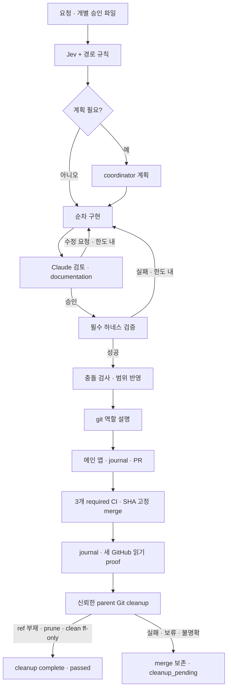

# 전체 하네스 설계

## 반복 JSON 실패와 세 번째 health 계약

[ADR0034](adr/0034-inspection-failure-recovery-and-health.md)에 schema·health wire와 복구 결정을 둔다.
Z.ai specialist의 승인 snapshot 기반 full schema와 scoped/read-only/native envelope·최종 client
semantic/evidence 검증을 유지한다. fallback·수선·재호출 없이 최초 오류/usage/telemetry를 보존한다.
검증된 discovery_schema Z.ai child만 정화 후 low effort·force effort·요청당8192 출력을 고정한다.
`MAX_STRUCTURED_OUTPUT_RETRIES=1`은 설치 CLI에서 같은1 invocation의 정상 Read 도구 대화와
첫 구조화 시도를 허용한다. parent 합성 재현에서0은 즉시 유효 구조화 응답이면 성공했으나
Read1개 뒤0attempts로 실패했다.1은 Read3개 뒤 유효 구조화 응답에 성공하고, Read2개 뒤
불량 구조화 응답에는 추가 repair 요청0으로 실패했다. `CLAUDE_CODE_MAX_RETRIES=0`과 실패 후
새 CLI 호출/재시도 금지를 유지한다. GLM forced thinking과480초 deadline·strict schema·최종 후보
검증은 유지하며 cap/프로토콜 거절도 실패다. 일반 Z.ai/Claude/Codex·parent 환경에는 적용하지 않는다.
환경 변수와 이전480.172811초 timeout·7.437927초 구조화 실패/검사 중단·새1/0 설정 검증 대기는
[모델 연결](agent-models.md)과 ADR0034에 둔다. 새 실제 GLM 성공은 아직 미검증이다.
별도 health는 cloud5역할의 고정 실패와 후속 성공을 구분하며 local/원문/키·비용은 private다.

기존 CLI tick의 정상 최종 save 뒤 discovery/state/source 잠금과 deadline 해제 후에만 기존
Store/sender/inbox로 health를 전달한다. 역할 실패 정산도 대상이나 초기 config/storage/lock/bootstrap
실패·rollback·같은 slot·no-deliver·조회/publish-morning은 대상이 아니다. qualified unattended 전송은
승인/실행 권한이 아니며 수동 trusted-parent/child/discovery 경계를 유지한다. 별도 trace/outbox/반환으로
원래 실패·ledger·불변 morning/completion을 보존한다. unknown은 GET만, 같은 digest의 명시 reconcile은
GET404 뒤 재POST한다. 새 cron·모델·source scan·fallback·Git 연결은 없다. runtime37와 상한을 유지하고
새 helper를 연구 승인에 넣지 않는다. 새 검토/full check·GLM probe·Sites 관측은 parent 책임이다.

검사 선택·CI 증명은 [ADR0031](adr/0031-change-scoped-automatic-validation.md)의 check_selection에 위임한다.
pytest_support의 실행·집계·worker 격리·정리와 runner 지연 import는 [ADR0032](adr/0032-parallel-local-regressions.md)를 따른다.

## 개발 실행과 읽기 점검의 잠금 격리

잠금 획득·책임과 이행은 [ADR0027](adr/0027-inspection-lock-isolation-and-diagnostics.md)이
정한다. workflow 전용 mutex는 실행 소유권, 기존 source inode는 capture/apply/cleanup/freshness를
보호한다. 모델·review·검사는 격리 사본에서 진행하며 apply의 전체 baseline/승인 freshness와
자신의 변경만 rollback하는 경계는 유지한다. tick은 discovery→artifact 아래 state를 보호하고
source 판단 때만 source mutex를 보유한다. source busy는 no-call이다. freeze는 admission 전,
publication은 state/source 잠금 밖의 sender 아래 frozen digest POST/GET이며 unknown 자동 POST는 없다.
기존 inode/root binding·legacy/storage 전환은 명시 조정 대상이다. storage 단독 import는 무I/O이고
이미 로드된 trace만 관측하여 원래 예외를 유지한다. 잠금 밖 state 쓰기·fallback 저장·retry는 없다.

[ADR0025](adr/0025-progress-preserving-improvement-reviews.md)의 두 private snapshot bank와
bounded manifest/fingerprint/owner/mode/nlink/size 검증·source-only 진행/cursor 보존을 유지한다.
seal이 유효해도 current freshness는 별개이며 새 capture/eligible/approve/execute는 현재 입력을 요구한다.
[ADR0026](adr/0026-source-verified-retained-improvement-reports.md)의 parent Read pairing·원래 bytes/
range hash·owner 프로그램 표본과 shared 문서·bounded rate_limit_event 무동작 처리·coverage를 따른다.
표본은 전체 완독 증거가 아니며 malformed/미완료/후속 tool은 거절한다. 완료 index의 ID별 최신
verdict/provenance와 cloud admission history의 오전 window는 독립적이다. 현대 proof/binding 표식은
legacy로 낮추지 않고 완료 outbox는 원래 검토·서명 증거를 보존하며 새 승인/만료 갱신을 하지 않는다.

실제 실패의 고정 detail API와 private 보존 경계는 아래 hourly 절과 ADR0027에 둔다.
새 reviewer는 최종 코드·문서의 의미를 다시 판단하며 offline 검증과 운영 성공은 별도 증거다.

## 로컬 실행·결과 보관과 실제 변경 검증

[ADR0021](adr/0021-local-work-and-result-archives.md)의 명시 v2는 local active artifacts/temporary와
별도 archive spec을 구분한다. archive parsing은 lexical/type/overlap만 확인하고 local hot path에는
archive 조회를 추가하지 않는다. v2는 remote work root/active/report를 거부한다. v1/no-config·
명시 기존 설정은 유지하고 역사적 NFS journal은 원래 v1 config로 조회·재개한다. 과거 NFS 유지
지시는 개발 active 선택에 한해 새 사용자 요청으로 대체되며 daily/hourly·게임 cron·approval은 유지한다.

archive.py의 bounded terminal allowlist freeze/전송은 [0021](adr/0021-local-work-and-result-archives.md#불변-payload와-원자-공개)을
따른다. Git 최종 save→project/GitHub lock 해제→completion hook 뒤 호출한다. standalone도 지원하고
파생 v1은 nested archive를 막는다. workspace/credential/raw 응답은 제외, pending/nonzero는
outcome/merge/cleanup과 별개다. local no-replace rename, remote exclusive0700/no-replace link와
receipt의 manifest/device/inode/mount/token binding을 유지한다. fresh readiness/attachment·
동일 prefix·fsync·inventory/hash 뒤 마지막 commit/정확한 네 파일0600/nlink1 readback을 요구한다.
동일 inode/nlink2의 알려진 alias만 정리한다. unknown/충돌/변조·receipt 전 mkdir 중단은 보존한다.
archive-only는 frozen/current를 재대조하며 journal을 대체하거나 workspace/backup/floor를 없애지 않는다.

[0028](adr/0028-resumed-run-result-archives.md)의 trusted-parent 명시 failed→passed 추가 보관은
원래 review/diff/검증 불변과 실제 Git/CI3/cleanup 증거를 요구한다. 최초 보관은 읽기만 하고
private record가 원래 run/이전 manifest/receipt/현재 inventory/별도 고정 세대를 연결한다.
원래 archive mutex와 전송 검증을 공유하고 동일 결과만 재개한다. child/discovery는 storage 전
거부하며 CLI/환경은 인간 인증이 아니다. status는 archive_original/현재 archive를 구분한다.
새 모델/검사/Git/승인은 없으며 실제 최종 readback·불변 대조는 parent 책임이다.

[ADR0022](adr/0022-documentation-only-validation.md)의 docs-only 선택은 scope/모델 주장 대신
최종 baseline→candidate bytes/mode/type diff를 사용한다. 정책/하네스/공통 설정/계약/불명은 full이며 repair마다
재판단한다. validation_selection·검사 digest·delivery_validation을 반영·게시까지 결합한다.
로컬 mode 기록은 POSIX 정수를 유지해 동일 0664/0640/0600 등 일반 비실행 권한을 허용하고
실제 권한 변경·실행/special bit·invalid mode는 full로 보낸다. 추가/삭제는 존재하는 쪽을 검사하며
CI raw Git mode 문자열은 기존 100644 기준을 유지한다.
check-docs는 Python 3.8 stdlib로 링크/Unicode heading·fragment·삭제/rename 역참조를 검사하고
외부 HTTP·예제 실행은 없다. unsupported Markdown은 오류며 의미적 완전성은 Claude가 판단한다.
inline code는 같은 block의 줄바꿈·정확한 backtick run·code 안팎의 escape를 구별해 마스킹하며
원문 줄 번호·heading 텍스트·뒤의 실제 링크 검사와 fence 경계를 보존한다.
CI complete event diff와 세 required final gate는 positive selected/passed·zero skip의 docs 증거
또는 ADR0031의 계획에 일치하는 모든 실행 성공/예정 skip을 요구한다. 작업 branch push는 자동
실행하지 않으며 master push·PR·수동 실행을 유지한다. ADR0023의 직접 호출용 전체 비교 구현과
불명 metadata/history·공통 조상 없음/복수·dirty/untracked/head 불일치·빈 diff의 full fallback은 유지한다.
trusted parent의 최종 archive.py 실제 NFS 저장/readback/hash·동일 결과 멱등 재개 성공 관측은
일반 pipeline 전체 성공이 아니다. 이번 수정은 새 실제 Claude 검토·full make check·실제 문서 검사·
GitHub/CI 검증이 필요하다.

기록일: 2026-10-11. Codex 경고·성공 판정과 머지 후 정리 정책 갱신: 2026-10-12.
설정 가능한 저장 경계 갱신: 2026-10-13.
승인 대기 일일 개선 발견 경계 추가: 2026-10-15.
bounded hourly 연구·MLX 작은 window·불변09:00 보고 분리: 2026-10-16, ADR0017.
이 문서는 현재 소스의 설계와 검토 기준을 Git에 남긴다.
명령·설치 절차는 [하네스 사용법](harness.md), [자동 작업 실행](workflow.md),
[모델 연결](agent-models.md), [접수 판단](triage.md), [대화 압축](compaction.md)에 둔다.
서비스의 데이터 책임은 [프로젝트 지도](architecture.md), 계약은 [데이터 계약](data-contracts.md),
주요 결정과 대체 이력은 [ADR](adr/README.md)에서 관리한다.
이 문서의 검증 설명은 소스에 정의된 경로와 게이트이며 특정 실행의 성공 기록이 아니다.

## 승인 제안 완료 전달

[ADR0020](adr/0020-automatic-proposal-completion.md)의 별도 전달 경계다.
`git_publish.main`의 request/accept/resume/cleanup이 마지막 save를 마치고 project/GitHub
lock을 모두 닫은 후 lazy import로 같은 run의 completion을 호출한다. Store → project를 쓰는
기존 execute와의 역순 lock 획득을 피하며 project lock 재획득·새 모델·승인·execute·GitHub
mutation·cron/tick 연결은 없다.

완료 검증은 현재 선택된 root의 private run과 github-v1 journal/publication snapshot에 한정한다.
`validate_journal`을 재사용하고 정확한 report.run_id/passed, PR 저장소·번호·URL, merged 40hex
SHA/done, 원래 CI 3종 success와 일치하는 head/merge SHA의 verified cleanup proof/CI 및
cleanup_complete를 요구한다. 각 claim과 approval을 Store.verify로 검증하고 proposal digest/ID,
authorization_id, approved decision, 독립 review 및 실제 구현 review·final validation·허용 scope와
적용 파일을 대조한다. signed run association이 없는 일반 작업은 키/credential/HTTP 없이 종료한다.
여러 signed claim은 각각 검증하며 일반 bundle 승인은 추가하지 않는다. 실행 전 freshness를
완료 시 재실행하지 않으며 claim 당시 유효기간만 확인한다. child/discovery/unattended,
read_only/simulated/GIT=0/local-only는 전달할 수 없다.

선택된 improvements root의 `completions/<run_id>/<proposal_id>.json` 한 원자 checkpoint에
최초 고정 completed_at과 canonical payload/digest, private 연결 ID 및 journal 상태를 함께
0600으로 저장·fsync한다. POST 전 sending도 먼저 저장한다. 16384 byte 한도의 exact
completion-v1 POST 뒤 strict schema/digest/payload GET 일치만 delivered다. sending/unknown의
자동 재호출은 GET만 하고 absent는 unknown을 유지한다. 명시 reconcile만 GET absent 뒤 같은
digest POST를 허용한다. conflict는 overwrite/retry하지 않고 delivered는 HTTP를 반복하지 않는다.
불명확한 응답·중단은 정제 journal 상태로 남고 passed/merge/cleanup이나 frozen morning report와
publication journal을 변경하지 않는다. 같은 private inbox와 기존 TLS/no-redirect transport를
재사용한다. wire/API·browser overlay·서버 immutable create-if-absent는 [운영 계약](improvements.md#승인-제안-자동-완료-전달)에 둔다.
Sites API/UI·인증 관리·배포는 메인이 맡으며 offline fixture는 실제 배포나 HTTP 성공 증거가 아니다.

## 목표와 비목표

목표는 운영 상태를 건드리지 않고 작은 재현 가능한 입력으로 실제 로직과 경계를 검증하고,
개발 요청을 명시적 파일 범위 안에서 배정·구현·검토·검증·반영·게시하는 것이다.
검토 판단, 필수 검증의 coverage, 실패와 대기 상태를 구분하여 기계가 읽을 수 있는 결과를 남긴다.
현재 코드 설명뿐 아니라 선택 이유·비용·한계를 설계서와 ADR로 유지한다.

전체 게임 데이터·모든 Lua 수식·모든 지역 화면의 정확성을 보증하거나 운영 DB를 보정하는 것은
목표가 아니다. cron·전체 다운로더·운영 importAll·배포는 개발 흐름의 부수 단계가 아니다.
모델 작업 사본은 일반 목적 VM 보안 경계가 아니며, 모든 공급자의 월 비용 통합 집계나 자동
Opus escalation·다른 유료 공급자 전환도 제공하지 않는다. 기본 검사의 성공을 선택 검사나
실사이트 정상 동작의 증거로 바꾸지 않는다.

## 구성과 책임

| 구성 | 책임 | 실제 진입점 |
| --- | --- | --- |
| 메인 Codex `/root` | 요청·개별 읽기 범위 준비, 부족 범위 확인, 앱 요청 실행, 머지 후 증거 기반 브랜치 정리와 최종 결과 보고 | [AGENTS.md](../AGENTS.md), [workflow 사용법](workflow.md) |
| 접수 판단 | 경로 규칙에 Jev 영역·복잡도·계약 영향 추가, 보수적 fallback | [triage.py](../harness/triage.py), [triage-config.json](../harness/triage-config.json) |
| 실행기 | 두 사본 생성, 순차 역할 실행, schema·수정 한도·검토·필수 검사·반영 게이트 | [workflow.py](../harness/workflow.py), [workflow-config.json](../harness/workflow-config.json) |
| 모델 연결 | 역할별 CLI·인증·파일 도구·예산·환경 분리, 고정 압축 연결 | [agent_models.py](../harness/agent_models.py), [agent-models.json](../harness/agent-models.json), [compaction.py](../harness/compaction.py) |
| 작업 사본 | 승인 소스 복사, 로컬 검증 사본, 범위 동기화·hash 충돌 검사·백업·교체 | [workspace.py](../harness/workspace.py) |
| 저장 정책 | 산출물·비인증 임시 경로, mount·공간·private 검사, 기존 실행 조회와 고정 로컬 lock 경로 제공 | [storage.py](../harness/storage.py), [설정 예제](../harness/storage-config.json.example) |
| 검증 실행 | 새 프로세스·임시 파일·실제 Django 테스트 DB/migrations, 구조화된 coverage | [runner.py](../harness/runner.py), [django_runner.py](../harness/django_runner.py), [Makefile](../Makefile) |
| 실패 피드백 | 로컬 실패 위치를 승인 소스에 귀속하고 안전한 제한 진단만 재수정에 전달 | [failure_feedback.py](../harness/failure_feedback.py) |
| GitHub 게시·정리 | 모델 설명과 별개로 journal·정책·SHA·앱 응답·CI·merge 및 cleanup 완료 검사 | [git_publish.py](../harness/git_publish.py), [git_cleanup.py](../harness/git_cleanup.py), [git-publish-config.json](../harness/git-publish-config.json) |
| 개선 연구/보고 | durable hourly slot·Claude ledger·quota admission·9단계 round·오전 journal; 승인 상태 생성 금지 | [improvement_loop.py](../harness/improvement_loop.py), [improvements](improvements.md) |
| 승인 제안 완료 | signed approval/claim과 run 완료 증거 검증·private outbox·동일 digest 전달/복구; 실행 권한 없음 | [improvement_completion.py](../harness/improvement_completion.py), [ADR0020](adr/0020-automatic-proposal-completion.md) |
| 로컬 탐색 | 승인 owner source의 연속 numbered window·정제 feedback만 text MLX HTTP로 전달 | [local_model.py](../harness/local_model.py), [local-models](local-models.md) |
| CI | 오프라인·MySQL·Chromium을 각 작업에서 실행하고 산출물 보관 | [harness.yml](../.github/workflows/harness.yml) |

다운로더는 수집·압축 해제·번역 준비, 파서는 형식 해석·게임 값·JSON export,
importer는 비교·ID 정규화·DB 적재, Django는 ORM·HTTP 서빙을 담당한다.
그 책임을 하네스가 대신 구현하지 않고 실제 경로를 테스트에 연결한다.

## 고정 입력과 실제 검증 경로

`runner.py`는 그룹별 새 프로세스와 `HARNESS_WORK_DIR` 임시 디렉터리를 사용한다.
기본 설정은 `TavernofSoul/TavernofSoul/settings_harness.py`이며 SQLite `:memory:`와 임시 JSON을
사용한다. 기존 `settings_test.py`는 운영 MySQL·JSON을 참조할 수 있으므로 격리 설정으로 사용하지 않는다.
`django_runner.py`는 실제 DiscoverRunner의 테스트 DB·migrations 수명주기를 사용한다.

기본 `check`는 downloader·parser·Django 회귀와 pipeline을 모두 실행한다. parser 그룹은
`parser_tidy/tests/test_*.py`의 선택 범위와 `harness/test_*.py`를 포함하므로 workflow 회귀도
기본 게이트에 들어간다. pipeline 그룹은 `harness.tests`, `combat_tests`, `contract_tests`,
`world_tests`, `regional_tests`, `equipment_tests`를 실제 Django runner에 연결한다.
아이템·스킬·몬스터·드롭·맵·속성·버프·지역별 장비·카드·컬렉션·젬 원본 fixture는 실제 파싱,
Lua 계산, export, importer·ORM·검색/상세 HTTP로 연결한다. 유형별로 JSON까지만 검사하거나
별도 고정 JSON을 계약 입력으로 사용하는 coverage도 있으며 [사용법의 상세 범위](harness.md)에 구분한다.
일부 sample 통과를 전체 main.py·binary IES 해제·운영 계산식 검증으로 해석하지 않는다.

다운로더 테스트는 인터넷을 차단하고 고정 urllib 응답을 공급한다. 다운로드 저장·PAK 해제·번역
복사·버전 기록은 실제 Python 로직이며 네이티브 IPF는 stub으로 호출 순서·오류 처리를 검사한다.
이는 외부 서버 가용성·실제 복호화/IES 변환 정확성의 증명이 아니다.
parser/export 실패의 공개 JSON·버전 보존, importer 적재 실패의 DB·Version·prev 보존과 재시도는
각 경계 검증의 목적이다. 운영 디렉터리 전체에 대한 원자 롤백을 주장하지 않는다.

검사 종료 코드 0만으로 성공 처리하지 않는다. 선택 테스트 0개, skip/xfail, 구조화된 failures/errors,
누락·잘못된 보고서와 비정상 프로세스 종료는 실패다. 이전 보고서를 제거해 과거 성공이 crash를
덮지 못하게 한다. `runner.py`의 EXCLUDED에 명시한 기존 local baseline 및 kTOS unpack 의존
테스트만 기본 범위에서 제외하며 제외 사유·deselect를 기록한다. 제외 범위를 성공 근거에 포함하지 않는다.

### fixture 준비·복원과 최적화 검토

[parser_fixture.py](../harness/parser_fixture.py)는 호출자가 제공한 임시 프로젝트에 고정 입력을
복사한다. world는 combat 입력에, regional은 world 입력에 지역별 입력을 더하며,
지역 번역·보충 JSON·iTOS 드롭 소스 선택도 그 임시 프로젝트 안에서 준비한다.
[fixture_inputs.py](../harness/fixture_inputs.py)는 필수 입력 경로를 선언하고,
[contract_fixture.py](../harness/contract_fixture.py)는 직접 작성한 계약 경계 JSON을 더한다.
기대값은 파서 출력으로 생성하지 않는다. 비교용 공개 bytes snapshot은 실패·재시도 때의
보존 여부를 확인하는 자료이며 게임 값의 독립 기대값을 대신하지 않는다.

`parse_workspace()`는 필요한 입력을 확인하고 호출마다 새 DB 데이터 컨테이너와 `file_dict`를
준비한다. `isolated_parser_state()`는 기존 Lua runtime·함수/source 테이블, 아이템 계산 상태,
스킬 EFFECTS와 몬스터 계산 테이블을 보관하고 새 상태로 파싱한 뒤 `finally`에서 기존 객체를
복원한다. 선택 도메인의 파싱이 끝난 뒤에만 export한다. 이 fixture 준비·복원 정책을 유지하며,
최적화의 임시 ID set·디렉터리 인덱스·검증 결과를 전역 복원 목록에 추가해 호출 간 공유하지 않는다.
같은 객체를 직접 재호출하거나 입력을 수정하는 합성 회귀는 새 fixture만으로 상태 누출을
가리지 않도록 별도로 작성한다.

XML 빠른 경로, JSON 중복 유한성 순회 제거, 스킬 일괄 cleanup과 맵 디렉터리 인덱스의
검토 기준은 [하네스 사용법](harness.md#최적화-회귀와-성능-근거)에 둔다. 실제 최종 내부 검증
경계와 상태 수명은 [architecture](architecture.md)와 [data-contracts](data-contracts.md)에
반영해야 하며, JSON 검증 분리 결정은 `docs/adr/0008-json-validation-single-pass.md`와
[ADR 목록](adr/README.md)에 기록해야 한다. 하네스의 회귀 명세만으로 이 문서 작업을 대신하지 않는다.
범위가 제한된 leaf worker는 검사를 실행하거나 재위임하지 않는다. 메인 오케스트레이터가
최종 소스 검증·지역별 전체 실데이터 및 누적 성능 비교를 수행하고 실제 근거를 보고한다.

## 기본 경로와 선택 환경의 경계

| 환경 | 입력·격리·검증 | 기본/CI와의 관계 |
| --- | --- | --- |
| SQLite | 합성 고정 입력, 메모리 DB, 임시 JSON, 실제 migrations·ORM·HTTP | 로컬 기본 `check` |
| MySQL | 명시적 테스트 접속과 제한 계정, `settings_harness_mysql.py`, 같은 통합 그룹과 MySQL 전용 검사 | 별도 `check-mysql`; CI `MySQL harness` |
| Chromium | fixture를 적재한 임시 Django 서버와 실제 브라우저, 엔진 보고서까지 요구 | 별도 `check-browser`; CI `Chromium browser harness` |
| live | 검토된 작은 iTOS/kTOS 원본 snapshot의 hash/revision, parser→SQLite→views | 별도 `check-live`; CI 오프라인 작업에서 기본 check 뒤 실행 |
| site | 설정된 iTOS/kTOS 공개 HTTPS에 GET/HEAD smoke | 별도 `check-site`; merge 필수 CI 밖 |

[mysql.sh](../harness/mysql.sh)는 digest 고정 MySQL 8.4의 일회용 컨테이너·임시 저장소를
생성·정리한다. [browser.sh](../harness/browser.sh)는 Chromium 엔진만 컨테이너에서 실행하며
운영 DB·JSON·소스·인증을 mount하지 않는다. 브라우저 SDK만 읽기 전용 mount한다.
아이템 검색은 경로별 새 context의 첫 요청부터 감시·routing으로 외부망·HTTP·console·
JavaScript 오류를 수집한다. page 뒤 interception 변경은 피한다. 실제 Control-click은
trusted 이벤트의 기본 동작·문서 응답·원래 화면 보존, 별도 `target=_blank`는 새 Page·
예상 URL의 완전한 DOM을 검증한다. finally에서 context 전체를 닫는다. 계약은
[ADR0029](adr/0029-item-search-progressive-enhancement.md), 현재 검증 순서는
[검색 인계](harness.md#아이템-검색-계약의-격리-검증과-인계)에 둔다.
상세는 23×2=46조합, 320px는 mobile 내부다. no-JS 준비 관찰·CSS 순서·실패 복구는
[ADR0030](adr/0030-item-detail-mobile-layout.md)을 따른다.
설치·Docker·외부 site 요청은 선택 경로의 명시적 운영 준비/실행이지 기본 오프라인 검사 부작용이 아니다.
CI는 현재 Ubuntu 22.04·Python 3.8·Node 22를 사용하고 의존성/브라우저 설치 뒤 검사한다.
따라서 오프라인이라는 말은 고정 입력 검증의 데이터 경계를 뜻하며 CI 환경 설치까지 무통신이라는 뜻은 아니다.

## 공유 저장 정책과 실패 경계

`resolve_storage(ROOT, env=..., fs=...)`는 호출 시점에만 정책을 읽는 단일 진입점이다.
workflow·git_publish와 cleanup guard·agent_models 보고서·triage·compaction·runner·컨테이너 wrapper가
이를 공유하며 import 단계에 설정 읽기·mkdir·mount 검사를 수행하지 않는다.
호출자의 현재 ROOT와 기존 REPORTS를 전달하여 테스트에서 바꾼 root가 원본 프로젝트의 private 설정을
읽지 않게 한다. 오프라인 회귀는 `tmp_path`와 `FileSystem`의 mount/공간/probe seam을 사용하며
실제 NFS·인증·운영 자료를 필요로 하지 않아야 한다. CI와 기존 필수 검사 범위를 축소하지 않는다.

설정은 다음 순서로 하나를 선택하며 병합하지 않는다.

1. `HARNESS_STORAGE_CONFIG`가 있으면 그 정규화된 절대 경로의 JSON을 반드시 사용한다.
2. 없으면 무시되는 `ROOT/logs/harness/storage-local.json`이 존재할 때 사용한다.
3. 선택적 기본 설정 파일도 없으면 기존 로컬 정책을 사용한다.

명시적 파일 누락·빈/상대 경로, 존재하는 설정의 malformed JSON·중복/알 수 없는 필드·잘못된
version/타입·symlink는 오류다. 설정 실패나 mount·공간·권한 실패에서 로컬로 fallback하지 않는다.
오류는 고정 진단만 제공하며 설정 원문·임의 OS 오류·secret 값을 보고서에 넣지 않는다.
version 1 schema는 정확히 `{version: 1, artifacts: {...}, temporary: {...}}`이며 각 객체는
정확히 `path`, `required_mount`, `min_free_bytes`를 갖는다. 두 application path는 정규화된 절대 경로,
서로 겹치지 않는 저장소 상위·하위 밖의 경로, required mount의 엄격한 하위 경로여야 한다.
공유 mount는 허용하며 하한은 bool이 아닌 0 이상의 정수 byte 수다.
[추적 예제](../harness/storage-config.json.example)만 배포하고 실제 호스트의 private 설정은 추적하지 않는다.

| 용도 | 설정 없음 | 설정 있음 |
| --- | --- | --- |
| 일반 보고서 | 기존 `ROOT/logs/harness` 및 호출자별 category | `artifacts.path` 및 category |
| 새 workflow run·검증 소스 사본·checks·backup·journal | `ROOT/logs/harness/workflows/<run_id>` | `artifacts.path/workflows/<run_id>` |
| 승인 파일 모델 context | `/tmp/tavern-model-context-*/sources` | `temporary.path/tavern-model-context-*/sources` |
| 비인증 검증 임시 | 기존 `tempfile` 기본 동작 | `temporary.path`의 고유 private 작업 디렉터리 |
| 프로젝트 lock | 로컬 `ROOT/logs/harness/workflows/.lock` | 같은 로컬 경로 |
| 인증·키·공급자 runtime | 기존 로컬/private 위치 | 같은 로컬/private 위치 |

`report_dir(category, explicit=..., local_default=...)`와 `workflow_root()`는 경로를 선택하고,
쓰기 호출자는 `ensure_directory()`/`prepare()`를 사용한다. 보고서 우선순위는 명시적 `--report-dir` →
`HARNESS_REPORT_DIR` → 설정 artifact/category → 호출자의 기존 local default다.
override는 인증 home을 선택하지 않으며 설정의 readiness 검사도 우회하지 않는다.
`mkdtemp(purpose='context'|'validation')`와 `temporary_directory()`는 비인증 용도에만 사용한다.
임시 context manager는 자신이 만든 고유 디렉터리만 정리하며 과거 실행 자료는 관리하지 않는다.

`check_ready()`는 모든 configured mount가 실제 mount인지, 공간이 각 하한 이상인지 확인한다.
이를 mkdir·probe·산출물 쓰기 전에 수행하고 각 쓰기 경계에서 재확인한다. required mount가 없는
디렉터리를 로컬 출력 디렉터리로 만드는 것을 금지하며 application과 출력까지의 symlink·다른
nested mount도 거부한다. 준비 상태는 이후 쓰기를 보장하는 lease가 아니다.
경로/mount proof와 공간 측정을 분리하여 한 읽기 전용 경계 안에서만 required mount별 측정을
공유한다. shared mount의 두 spec은 서로 다른 floor도 각각 적용하고, 별도 mount는 각각
측정한다. 공유 중 mount device/inode가 바뀌면 실패한다. 측정/실패/probe 성공을 public 호출,
별도 쓰기, 시간 간격이나 cleanup 경계에 걸쳐 cache하지 않는다. 두 configured mount·floor와
기존 private root를 모두 확인한 뒤 첫 mutation을 허용하며 다음 실제 쓰기 gate에서도 다시
검사한다. 출력까지의 경로·nested mount 검사는 공간 조회 공유로 대체하지 않는다.
application 디렉터리는 프로세스 소유·0700을 요구하며 새 디렉터리만 private mode로 만든다.
기존 mount root나 unrelated 디렉터리를 chmod해 준비를 통과시키지 않는다.
실제 writeability probe는 application 안의 고유한 0600 파일을 쓰고 fsync·읽기·삭제한다.
`ensure_directory`와 임시 할당은 필요한 두 root의 생성을 유지하되 이미 검증된 디렉터리에
mkdir를 반복 시도하지 않는다. 새 root는 probe하고, 출력 자식·고유 임시 디렉터리는 실제 목적지에서
독립 probe한다. 목적지 자체가 새 root이면 그 probe는 출력 gate에서 한 번 수행한다. 무관한
기존 root의 반복 probe는 생략하지만 그 root의 mount/floor/소유자/0700 검사는 유지한다.
부모 성공을 자식 writeability로 해석하지 않으며 configured mount 밖의 explicit override도
자신의 private 목적지 probe를 요구한다. `probe=False`와 미설정 local 동작은 유지한다.
명시적 `prepare()`는 두 application을 준비해 모두 새로 probe하는 종합 진단이다. 각 생성과
뒤따르는 probe는 독립된 fresh gate를 거치므로 중간 악화는 다음 쓰기에서 차단한다. probe 실패는
고정 진단으로 노출하고 local fallback하지 않는다. 선택 근거와 비용은
[ADR 0018](adr/0018-storage-check-probe-deduplication.md)에 둔다.

호출 소유 tree cleanup의 진입과 최종 root 제거 직전 readiness는 독립된 두 경계다. 각 경계에서만
mount 측정을 공유하며 매 destructive 작업의 attachment·owner·no-follow·device·kernel mount
identity proof와 statx 실패 시 fail closed는 그대로다. cleanup의 범위와 부분 실패 계약은
[ADR 0013](adr/0013-owned-validation-temporary-cleanup.md)을 유지한다.
JSON·이벤트·로그 0600과 실행 디렉터리 0700 정책을 유지한다.
MySQL/Chromium wrapper는 초기 상태 쓰기·trap의 결과 쓰기·Docker 시작 전에 이 정책을 해석/준비한다.
Docker 데이터베이스·운영 저장소·컨테이너의 기존 tmpfs 정책은 이 설정으로 옮기지 않는다.

유료 모델 없이 `make storage-status`, `make storage-doctor` 또는
`python -m harness.storage status|doctor`로 유효 artifact/temp/context/local lock 경로와 mount·공간
하한을 조회한다. 기본 조회는 읽기 전용이며 application이 아직 없어도 쓰기 가능성을 증명하지 않는다.
`status(probe=False)`는 mkdir·chmod·probe를 하지 않고 실패 시에도 각 spec의 `mount_ready`,
측정된 `free_bytes`(floor 미달 값 포함), `min_free_bytes`를 유지한다. 공간 조회 실패는 null이다.
`status/doctor --probe`/`make storage-doctor PROBE=1`은 두 기존 private application을 모두 요구하고
각각 새 gate에서 probe한다. `python -m harness.storage resolve artifacts --prepare`는 필요한
두 root를 만들되 새 root와 요청한 실제 목적지를 probe하며 무관한 기존 root는 probe하지 않는다.
public 서명/반환 형태·CLI schema, 설정 bytes/mode·NFS 선택·mount options·required mounts·floor와
기존 환경/credential/lock·모델/provider·게시 정책은 유지한다. 남은 NFS RPC 지연은 제거하지 않으며
합성 회귀의 호출 수 감소는 end-to-end 성능이나 필수 검증 통과의 증거가 아니다.
명령 성공은 모델·검증·게시 성공이 아니다. 설정 준비/복구 절차는 [하네스 사용법](harness.md)과
[workflow](workflow.md), 외부 저장·로컬 lock·인증 유지 결정은 예정
[ADR 0011](adr/0011-configurable-harness-storage.md)에 기록한다.

## 개발 요청에서 GitHub 완료까지

메인은 요청과 외부 모델이 읽을 소스·테스트·문서·예정 신규 파일의 개별 경로를 준비한다.
실행기는 준비 검사 doctor를 먼저 수행하고 Jev를 관측한다. 경로 규칙이 최소 필수 검사를 결정하며
Jev는 이를 낮추지 못한다. Jev recommendation과 모든 승인 경로의 owner가 같은 단일 역할이면 coordinator도 직접 배정한다.
추천 불일치 또는 mixed ownership은 coordinator 계획으로 간다. [ADR0033](adr/0033-workflow-token-efficiency.md)의
prompt builder는 원요청·scope·feedback·full diff를 보존하고 검토에 task별 최신 결과를 제공한다.
원본 실패 이력과 fresh full review는 유지하며 agent_usage는 private 숫자 관측만 담당한다.
usage와 prompt 크기는 청구/구독·admission 판단을 대신하지 않는다. 검토 후 실제 변경으로
검사를 다시 정하며 계약 영향·실제 공통 변경은 full이다. fallback만으로 full을 추가하지 않는다.
triage 단독 명령은 shadow 기록이며 `execution_allowed=false`다. 실제 실행 주체는 workflow다.

계획 JSON은 정확히 `tasks`; 각 task는 `role/task/files`이며 승인 파일을 정확히 한 번씩
소유 역할에 배정한다. 공통 하네스·문서는 coordinator, downloader/parser_tidy/TavernofSoul은
각 담당자이며 `workflow.owner()`의 세 parser_tidy Django 회귀 파일은 django에 배정한다.
작업은 계획 순서대로 실행한다. 계획 schema는 파일 배정만 검사하며 문서 필요 여부의 의미 판단은
지침과 reviewer의 책임이다. 읽기 전용 참조도 승인 파일 배정에 포함하되 task 설명으로 편집 대상과 구분한다.

구현 후 모델 사본의 승인 변경만 검증 사본에 동기화하고 diff·실제 변경 목록으로 Claude 검토를 받는다.
검토 승인 뒤 경로·Jev·소유 역할의 필수 검사를 모두 실행한다. 모든 검사가 통과하고 검사 자체의
소스 변경이 없어야 원본 충돌 검사를 거쳐 반영한다. read_only·demo는 원본 반영하지 않는다.
기본 쓰기·변경 있음·게시 활성 상태에서는 git 역할이 설명 JSON만 반환하고 메인 앱에 넘긴다.

## 승인 게이트 시간별 연구와 오전 보고

개별 승인 경계는 [ADR0015](adr/0015-approval-gated-improvement-discovery.md), hourly/예산은
[ADR0017](adr/0017-budgeted-continuous-improvement.md), private 서술/public 표시는
[architecture](architecture.md#기존-private-서술과-공개-projection-검증), 실제 CLI·schema·복구는
[운영 계약](improvements.md)에 둔다. 기반 구현/직접 개발 요청의 전달 권한과 이후 발견 제안의
개별 승인 권한은 구별한다. 모델/provider/effort/compaction·auth·읽기 scope를 넓히지 않는다.

`improvement_report.py`는 I/O 없는 Python3.8 검증/정제/렌더러, `improvements.py`는 승인 scope·
직렬 role 호출·private 기록·승인/claim/전달, `improvement_loop.py`는 bounded 예약/정산과 오전 선택을
담당한다. 선택적 workflow `_improvement_guard(run_id)`는 project lock 안에서 쓰기 모델·사본·검사
전에 재검증한다. 직접 요청과 달리 자율 제안은 guarded entrypoint가 필수다.

legacy discover는 coordinator→downloader→parser→django→독립 reviewer, 활성 loop는 각 owner의
local→specialist 네 쌍 뒤 Claude reviewer의9단계다. tick당 최대1모델·로컬 포함 KST 하루24회,
마지막 stage 다음 slot에 새 round다. local 실패/빈 초안과 빈 pool도 정규 specialist/reviewer를
생략하지 않는다. owner는 workflow.owner와 shared_files의 승인 교집합만, reviewer는 별도 context의
전체 승인 scope를 본다. 기존 owner 예외를 유지한다. 0400 사본·write=False/scoped=True와 parent
격리에 의존하며 VM이나 임의 in-process Python에 대한 보안 경계를 주장하지 않는다.
원본 수정·검사·Git·workflow·운영 작업, symlink/보호 파일/private config는 모델 권한이 아니다.
Codex specialist discovery만 승인 workspace의 cat·sed -n·rg·ls·head 읽기를 허용한다.
다른 provider·reviewer·local 입력과 CLI·권한·network=false 격리는 유지한다.
specialist `approved_read_files`(legacy `read_files`)는 승인 목록이며 읽기 증거가 아니다.
private `observed_reads`는 완료 command_execution의 cat/sed/rg/ls/head/tail/other별
bounded 성공·실패·unknown 수와 가용성이다. 정상 0회와 관측 불가를 구별한다.
미지원 구문은 보수적으로 분류한다. 명령·출력 원문을 저장하거나 shell 성공을 읽기 증명으로 쓰지 않는다.
reviewer Capture/Read는 유지한다. identity 확인 뒤 참여/history/status에만 보존하며
실패·정산·공개·동결·승인 판단은 불변이다.

기존 한도는 보고3개·specialist 후보2개/전체8개, legacy5호출/600초/retry0, hourly tick600초/
cloud480초/quota15초·자정 guard600초·기본 완료 index16(최대32)이다. 파일128KiB·source1.5MiB,
context2MiB(소스+prompt UTF-8)·응답64KiB·scope64·edit_files12·근거/검증 단계 각6을 유지한다.
exact 필드/type/finite/bounds/관계 검증은 여전하며 호출 한도는 실제 달러 청구 보장이 아니다.

cloud specialist는 승인 경로 교집합의 정제 자문을 별도 구간으로 받는다. runtime key redaction 뒤
구분자 포함8192 UTF-8 bytes와 기존 전체 context 상한을 적용하며 base prompt도 정제한다. 자문은 증거·승인 권한이 아니다.
입력은 deadline/readiness 뒤 Store.lock 전, source/state 잠금 밖에서 연구 `store.root`와 `storage.resolve_storage(imp.ROOT, env={})`의
active `workflow_root(local_default=imp.ROOT/'logs/harness/workflows')`에서만 수집한다.
archive/fallback 검색은 없다. 그룹·구현 판정은 연구 `loop/issue-annotations.jsonl` 하나의 명시
annotation만 따른다. annotation 실패는 []이며 수집 상태와 별개다. no-follow 타입 확인 뒤
proposal 파일/run 쌍을 검증하고 실패 항목만 제외한다. archive·숨김 metadata·latest.json은
제외 대상이며 실패 수에 넣지 않는다. root 거절은 전체 records를 비우고 첨부0이다.
private reference_observation의 세 필드·legacy 생략을 보존한다. 실패 시 선택적
skipped_items(제외 proposal/run 수, 중복 없이0..4096), root_failure_codes/item_failure_codes/
annotation_failure_codes(고정 allowlist)를 남긴다. null은 미관측,0/[]는 관측된 무실패다.
collection_status는 정상 normal/무자료 empty, 항목 제외 partial(빈 records도), root 확인·잠금·
전역 상한 거절 unknown이다. annotation_used와 읽기 성공은 별개며 소급 추정하지 않는다.
조상은 dev/ino/mode/uid, 파일은 nlink1·전체 identity/bytes를 재검증한다.
진단은 private history/status에만 두고 public 세 계약·digest·승인·freshness에는 넣지 않는다.
한 번 수집한 진단을 전달하며 관측용 재수집·annotation 재읽기·재렌더는 없다. 기본 설정이 없고
legacy root도 부재/잠금 metadata뿐이면 unavailable이다. 기존 호출·예약/정산은 유지한다.

local adapter는 파일을 열지 않고 parent의 승인 snapshot 한 파일의 연속 numbered whole-line
window만 받는다. [로컬 계약](local-models.md)의 mlx-vlm0.7.8 native strict JSON Schema·
enable_thinking=false·닫힌 객체·owner edit_files enum과 두 evidence의 실제 window를 요구한다.
prepared immutable request의 config/user 결합과 canonical schema를 두 transport seam 전에
재검증해 누락/완화/owner/scope/window/thinking 변조·재조립 plain bytes를 거절한다. user JSON의
owner_role,sources,feedback,candidate_limit,approved_files 순서와 injection 경계는 유지한다.
request24576bytes에 schema/system/user/feedback 모두 포함하고 고정 overhead 초과는 no-call이다.
window96줄·feedback4096bytes·max_tokens3072·timeout180초·body65536/header8192bytes가 기본이다.
client shared validator와 독립 검토가 최종 권위이며 schema 미지원 uniqueItems·중복/start<=end·
총 문자량/의미·원문 줄 검증을 생략하지 않는다. 승인됐지만 미전송 파일은 편집 대상일 수만 있다.
window 밖 근거·경로 보정·줄 clamp·근거 합성·retry/fallback은 없다. 긴 한 줄은 slice 없이 skip하며
실패 cursor를 자동 replay하지 않는다. v2/mlx-vlm·api_model==model 상대 repository ID만 허용하고
v1 자동 이행·default_model/절대 모델 경로·DNS/proxy/redirect/remote_code/도구는 거절한다.
정상 assistant의 정확한 tool_calls:null/tool_call_id:null만 무동작 metadata다. 설치/서비스/private
설정 전환·실추론은 parent 소유이며 Linux MLX 의존성·SSH/home/key·repo복사를 추가하지 않는다.

실패 분류는 adapter의 실제 CLI/transport/응답, shared validator, `_call_role`의 identity/context/
JSON/review/cleanup 경계 책임이다. ADR0027의 identity-bound 예외/result detail만 전달하며 runner
JSON·예외문/자유 클래스명은 권위가 아니다. sanitize_detail은 저장/feedback 필터다. API/CLI 성공은
후보/review 성공이 아니다. broad reason·구체 cause/phase/field/rule과 실제 bounded 관측 정수만
scan_id/slot/9단계 index/stage/owner_role·admission started_at과 실제 call_started_at/call_finished_at에 연결한다.
finished_at의 기존 보수적 회계 보정과 실제 종료 관측을 구분하며 시계 rollback에도 관측값을 보존한다.
private cloud participation192건과 별도 local_history192건·scan/slot/status·bounded feedback으로 보존한다.
성공 참여의 허위 진단은 버리고 legacy 상세는 unknown/unavailable로 조회 투영하며 과거 기록을 추정하지 않는다.
후속 성공/재이행·정산 복구는 저장된 실패의 사유·초안 digest·호출 시각과 trace 첫 실패/원래 예외를 보존한다.
source/원문/cost는 history에 넣지 않는다. CLI 경고와 모델/tool 오류 문구는 실제 실패 원인의 증거가 아니다.

slot claim은 config/source/quota/model I/O 전에 durable 기록하고 count/reservation/cursor/inflight는
호출 직전 한 atomic write에 결합한다. discovery→artifact 아래 state, 필요한 짧은 source mutex만
획득한다. 최초 config/Store/readiness 실패는 private 결과만 남을 수 있고 보고/모델/키 조회를 하지 않는다.
source/config 미준비의 미완료 보고와 구별한다. interruption은 예약 소비 후 한 stage만 실패 진행한다.
no-call gate/quota/budget/source-lock의 실제 보류 이유를 실행 실패로 꾸미지 않으며 같은 slot 재호출·
잠금 밖 쓰기·fallback 저장·daemon/retry는 없다. source-only 변화는 pinned 진행/cursor를 유지하고
current freshness만 따로 판정한다. control/scope/ownership/provider/model/protocol 변화는 진행을
무효화해도 실제 참여/완료 index를 지우지 않는다. 호출 뒤 freshness도 확인한다.

Claude는 추정US$1/KST일, reviewer cap=min(0.20,잔액,기존한도)의 downward CLI override를 사전
예약한다. 성공 finite estimate만 정산하고 failed/unknown/interrupted는 전액 소비하며 관측 초과는
기록 후 당일 전체 중단이다. reviewer 예산 보류는 index를 유지해 후속 역할도 대기하지만 오전
freeze는 독립적이다. 구현 workflow 비용은 별도다. legacy 당일 비용/호출은 scan_id로 중복 없이
carry-in하며 unknown/incomplete를0으로 보지 않는다. rollback 거부·날짜 경계의 양일 count/charge/
중단과 자정 guard를 유지한다. GLM Coding Lite 고정 endpoint/auth와 매 admission parent quota 조회,
TOKENS_LIMIT/CREDIT_LIMIT5h·있으면weekly percentage/reset 검증·>=80%/unknown/실패 보류는
[운영 quota 계약](improvements.md#claude-추정-ledgerglm-구독-quota)을 따른다. 정확한 finite numeric0%
(bool 제외)의5h absent/null reset idle 예외만 유지하며 weekly/비영/잘못된 reset·실패 envelope·
TIME_LIMIT 단독·model limit 부재를0%로 해석하지 않는다. 명목20% 여유이며 유료 fallback은 없다.

private 후보/review/documentation은 기존 outer trim 뒤 전체 본문을 보존하여 reviewer 입력·canonical
ID/digest·저장/재검증·명시 승인/실행에 연결한다. public 상한4배의 수용 한도와 별도 표시 생략은
architecture와 운영 계약을 따른다. suffix도 원본 identity에 반영하며 상한/타입/UTF-8/control/unknown
key/scope/line 위반은 batch 거절이다. 모델 transport만 bare strict JSON 또는 전체 단일 소문자 json
fence를 허용하며 원래 bytes cap 검사는 wrapper 제거 전이다. config/storage/public은 fence를 거절한다.
LF/CRLF·바깥 whitespace/문자열 backtick 호환과 duplicate/NaN/overflow/invalid UTF-8/설명문/다중
block/truncation 거절은 유지한다. 추출/보정/재호출하지 않는다. reviewer는 모든 후보를 한 번씩
eligible/rejected/needs_evidence로 판단하고 후보별·전체 documentation={status,files,reason}을 낸다.
제안 자문의 required/missing/not_required와 구현 검토의 updated는 구별한다. 필요 문서는 정확한
edit_files에 있어야 하며 coverage/문서/검토 누락은 eligible을 만들지 않는다.

feedback은 candidate_id/draft_digest와 정제 issue·specialist/review 설명 및 선택적
specialist_failure_detail/review_failure_detail을 기존 bytes/redaction/최대4요약 안에서 다음 실제 local
prompt에 전달한다. 후속 의견에도 이전 실패 항목을 bounded 보존하고 전체 원본은 scan/history에 남긴다.
담을 수 없으면 보류하며 private 원문을 자르지 않는다. feedback은 근거나 실행 권한이 아니다.

trusted parent만 구체 ID와 nonsymlink0600 private 지시 파일로 승인한다. HMAC에는 proposal/review
전체 digest·읽기 fingerprint/bytes/mode/존재·정확한 edit/게시 scope·만료 기본7일·고유 authorization을
묶고 loop_dependencies digest도 provenance/discovery_fingerprint로 연결한다. _eligible/_fresh/
_authorization 및 workflow guard가 live config와 원본을 재검증하여 같은 ID 재발견으로 옛 승인을
새 설정에 결합하지 못하게 한다. claim은 실패/중단에도 일회성이며 원래 run 조정 뒤 새 명시 승인만
가능하다. unattended는 approve/reject/execute, child/discovery는 orchestration을 거부한다.
CLI/HMAC은 인간 신원을 증명하지 않으며 같은 OS 계정 탈취는 이 신뢰 경계 밖이다.

오전은 기존 cloud admission history의 `[전날09:00,당일09:00)` 마지막 실제 역할 시도와 현재
fingerprint 일치 완료 회차의 ID별 최신 명시 verdict/provenance를 독립 선택한다. distinct8후보의
priority(high/medium/low)/exact ID순 최대3카드이며 eligible 우선정렬이 아니다. counts는 전체를 센다.
latest 실패와 보존 eligible은 병존하며 검증된0개만 확인 범위 내 제안 없음이다. 표본 밖 무결함이나
별도 회차 참여를 제안의 원래 검토로 표시하지 않는다. private reviewed_agents에 원본을 보존한다.
09시 이후 첫 tick이 admission 전 모델 없이 한 번 freeze하고 그날 내용은 이후 연구로 바꾸지 않는다.
public web-v1/completion-v1·payload/digest에 새 진단/local/cost/source/원문/credential을 추가하지 않는다.

publication prepared에 report/payload/digest/limit를 먼저 고정한 뒤 day/scans/web/latest를 만들며
proposal pointer는 원래 round만 쓴다. crash는 exact prepared만 복구하고 기존 day는
legacy_preserved/existing_day_conflict로 보존한다. catchup은 오늘 하나, 과거 보고/모델 몰아호출은 없다.
CLI는 state/source lock 해제 후 stable sender와 기존 sender mutex 아래 HTTPS/no-redirect·시간/bytes
상한 POST→GET date/schema/canonical digest 확인을 한다. sending/attempt_id를 HTTP 전에 저장하며
failure/crash/모호함은 unknown으로 남겨 일반 tick/legacy API로 재전송하지 않는다. parent만 실제
결과 확인 후 같은 frozen digest를 명시 reconcile한다. 기존 성공 delivery는 HTTP 없이 정산한다.
receiver 날짜/digest idempotency가 필요하며 네트워크 전체 exactly-once 도착을 주장하지 않는다.
legacy daily는 failed/partial도 기존 day를 재사용하고 loop 뒤 새 daily는 loop_managed로 넘긴다.
manual discover는 trusted 호환 경로이며 frozen day를 덮지 못하고 hourly와 병행 예약하지 않는다.

과거 scan1792065346555306548-d8a875의416자 review 실패·이전3215passed, 두 prompt/order 수리의
full check 중단/applied=[]·복원 초안,2026-10-16 09시 partial/0개 전달과 사전 MLX 관측은 역사적
근거다. 기존 GIT=0/local apply와 create_tree 자동 승인 거부(공개 동의 부족)도 당시 이력이며
현재 승인·검증·운영 성공이 아니다. 원격 baseline 불일치·명시 승인 거부 시 중단한다.
최종 source의 새 Claude 의미 검토/documentation 판단·GIT=1 full make check(umask077/022 포함)·
scoped apply·기존 Git 역할 및 parent 게시/CI3/merge/cleanup은 필수다. status는 모델/키/quota 없이
마지막 tick의 추정 잔액·보류·다음 단계/보고·journal과 재정제 history만 보여 실청구/실시간 freshness
증거가 아니다. 스케줄/게임 jobs/private config·서비스 전환과 실제 hourly/오전 전달 확인은 parent 소유다.
worker는 검사를 실행하지 않으며 합성 회귀·문서 존재/확장자만으로 의미적 완결성이나 운영 성공을 주장하지 않는다.

## 역할 모델과 압축

현재 [역할 설정](../harness/agent-models.json)의 연결은 다음과 같다. 모델·예산을 문서화 때문에 바꾸지 않는다.

| 역할 | provider / model | effort · 호출 예산 |
| --- | --- | --- |
| coordinator / parser | codex / gpt-6.1-sol | high |
| django / git | codex / gpt-6.1-sol | medium |
| downloader | zai / glm-5.3-flash | CLI 설정에 effort·달러 예산 없음 |
| reviewer | claude / claude-sonnet-5-5 | medium · 호출별 2 USD |
| escalation | claude / claude-opus-5-5 | high · 호출별 5 USD; workflow 자동 호출 없음 |
| 접수 Jev | typesafe / jev-1.13.0 | timeout 8초; 오류 시 자동 API 재시도 없음 |

Codex는 ChatGPT 로그인, Claude/Z.ai는 분리한 API 인증·런타임을 사용한다.
Claude Code의 downloader/reviewer/escalation은 설정상 고정 압축 플러그인을 사용한다.
[compaction.py](../harness/compaction.py)는 실행 전 vendor의 source/compiled hash를 검사하며
자동 다운로드·업데이트하지 않는다. [압축 문서](compaction.md)에 기록된 upstream pin은
`e3f262a7f4d42bd8dd32ced30d26176f7cb545b0`, 모델은 `jev-1.13.0`이다.
오류·키 누락·입력 초과·효과 부족에서는 Claude 기본 압축에 맡긴다.
대화 텍스트·도구 입력이 TypeSafe로 전송되고 도구 결과는 크기/오류 메모로 바뀐다.
별도 TypeSafe 사용량은 Claude 달러 한도에 합산되지 않는다. `compaction.status=requested`는
로드 요청이며 성공 증명이 아니다. CLI 훅 거부와 모델 응답 성공도 별도로 보고한다.

### Codex 경고와 성공 판정

2026-10-12의 [ADR 0007](adr/0007-codex-warning-success-boundary.md)은 stdout/stderr 경고 분류보다
성공 증거를 우선 검증한다. 인증은 exit0와 정확한 ChatGPT 로그인 상태를 요구하고 API 키 인증을 거부한다.
역할 실행은 exit0·엄격한 JSON event 파싱·유효 최종 agent_message·turn.completed·failed/error event 없음,
smoke는 nonce 일치까지 요구한다. 생성·정리 실패와 timeout도 실패이며 성공을 보고하지 않는다.
PATH aliases 읽기 전용 warning 단독은 이 조건을 통과한 ready/passed를 실패로 만들지 않는다.
경고가 있어도 nonzero, 실패 event, malformed/미완료/빈 응답, 인증 실패나 nonce 불일치는 실패다.

private 보고서의 `warnings`는 고정 `stage/category` 목록만 보존한다. 현재 category는
`path_aliases_read_only`, stage는 `authentication`/`execution`이다. 인증 경고를 역할 실행까지 전달하며
stderr 원문·경로·인증은 저장하지 않는다. nonzero 실패 진단의 같은 category는 실패 분류일 뿐이고,
warning은 실패를 성공으로 바꾸거나 권한 확대·fallback·재시도를 허용하는 증거가 아니다.
검증 실패 응답은 저장하지 않고 신뢰된 최종 응답만 기존 private 보고서에 남긴다.
`workflow.model_step`은 결과 전체를 agents에 보존한 뒤 passed 및 scope를 확인하며 이후 새 Claude 검토·
필수 검사·충돌 검사·반영·Git/게시 게이트를 유지한다. 모델 passed는 전체 workflow 완료를 뜻하지 않는다.

메인 조사 요약에서 이전 일반 실행의 exit0 편집은 stderr 선판정으로 반영되지 않았다.
CLI 0.161.0 무추론 비교는 writable private runtime에서 exit0/경고 없음, `CODEX_HOME=/sys`와
나머지 private 경로 조합에서 exit0/경고 있음을 관측했다. 별도 draft 복구는 일반 경로 수리 검증이 아니다.
최초 경고 발생 하위 프로세스는 raw stderr 미보존으로 미확정이며 runtime deny가 하위 초기화 warning을
유발할 가능성은 추론이다. [공식 sandbox 문서](https://learn.chatgpt.com/docs/sandboxing)는 spawned commands에도
적용되는 일반 경계의 참고이며 PATH aliases 구현을 증명하지 않는다. 상세 사실과 한계는
[모델 연결](agent-models.md#실패-진단-읽기)에 둔다. [ADR 0002](adr/0002-explicit-model-read-scope.md)의
격리 결정을 유지한다. root0700/auth0600·runtime deny·root deny/minimal read·좁은 source/CLI/셸 예외·
network=false·모델/역할/예산은 변경하지 않는다.

오프라인 회귀 명세와 실제 관측은 구분한다. 수리 worker는 검사를 실행하지 않았다. 문서 의미 판단은
새 Claude 검토가 맡고 full make check·일반 Codex 도구 편집 실호출·Git 역할·GitHub PR/CI/merge는
메인/orchestrator가 수행해야 한다. private 로그 원문을 설계 문서로 옮기지 않는다.

## 실패 복구와 필수 게이트

[workflow-config.json](../harness/workflow-config.json)의 현재 한도는 max_tasks=8,
max_plan_attempts=2, max_rounds=2, 모델 timeout=900초, 검사 timeout=1800초다.
파일 32 MiB·snapshot 128 MiB·diff 512 KiB를 넘으면 자르지 않고 실패한다.
계획 JSON 문법/schema만 고정 진단으로 한도 내 새 계획을 요청한다. scope/소유권 위반,
planner 쓰기·CLI 실패는 복구 대상이 아니며 잘못된 모델 원문·임의 예외를 다시 보내지 않는다.

검토 수정 요청과 검사 실패는 원래 task의 정확한 파일에 귀속한다. 필터는 실패 위치를
승인 소스에서 확인하고 명령·고정 분류·허용 예외 타입·줄 번호·최대 7줄의 짧은 소스만 전달한다.
private 로그 원문·런타임 값·매개변수 test ID·임의 오류 메시지는 전달하지 않는다.
위치/문맥을 확인할 수 없으면 unavailable/unattributed로 표시하고 남은 라운드에서 최초 task
전체에 원인 없는 제한 메타데이터만 전달한다. 부족 문맥은 메인이 조사해 범위를 확인한다.
이 필터는 키 치환과 별개이며 원인을 확정하는 기능이 아니다.

수정 후 항상 새 reviewer 검토와 최초 필수 검사 전체를 다시 요구한다. 총 구현 라운드가
max_rounds를 넘지 않는다. fingerprint·task·라운드·구현 전후 hash·피드백 전송을 기록하고,
마지막 실패는 동일 실패와 소스 무변경이면 no_progress, 그 외에는 exhausted_repair로 종료한다.
읽기 전용 실패는 수정 재시도하지 않는다. 검토 출력 형식 오류는 즉시 실패다.

매 reviewer JSON은 정확히 `verdict/summary/findings/documentation`을 갖는다.
summary와 finding message는 공백 제외 비어 있지 않은 문자열이고 findings는 최대 32개다.
각 finding은 승인 file·high/medium/low severity·message만 가진다.
approved는 빈 findings, changes_requested는 비어 있지 않은 findings를 요구한다.
documentation은 정확히 `status/files/reason`; reason은 공백 제외 비어 있지 않은 문자열,
files는 중복 없는 승인 `.md` 경로 목록이다.

- updated: 실제 변경 `.md` 파일 최소 하나가 필요하며 scope 밖·비문서·미변경 참조를 거부한다.
- not_required: files=[]와 구체적인 문서 생략 이유가 필요하다.
- missing: changes_requested 및 기존 승인 파일에 귀속한 finding이 필요하며 approved를 허용하지 않는다.
  files는 빈 목록 또는 승인 `.md` 경로다. 필요한 문서가 scope 밖이면 reason/message에 누락 경로를 쓴다.

필드 누락·잘못된 schema·verdict 모순은 fail closed다. 문서 확장자·실제 변경 검사로 의미적
완전성을 주장하지 않는다. reviewer가 요청·코드·문서를 판단하며 updated라도 다른 finding이
있으면 수정 요청이다. read_only·demo에도 같은 판단 필드를 둔다.
[test_workflow.py](../harness/test_workflow.py)는 이 게이트·반영 차단·재수정·직접 배정·데모 경로를
fixture로 검사하도록 작성되어 있다. 실제 검사 결과는 실행별 보고서로 확인한다.

## 두 작업 사본과 보호 범위

[workspace.py](../harness/workspace.py)의 모델용 사본은 공유 정책의 context root 아래
`tavern-model-context-*/sources`에 승인된 개별 파일만 복사한다. 기본 context root는 `/tmp`이고
설정 사용 시 `temporary.path`다. 항상 저장소의 상위·하위 밖에 두며 미승인 AGENTS·설계서·
부모 지침·다른 소스는 자동 제공하지 않는다.
예정 신규 파일은 경로만 승인하고 아직 없으면 복사하지 않는다. 읽기 전용도 같은 읽기 범위다.
Codex는 root deny·minimal read·승인 workspace read/write와 CLI/셸 실행 파일만 허용하는 프로필,
도구 network=false·자동 지침/skill/apps 로딩 비활성화를 사용한다. 인증은 CLI의 private 임시
런타임에만 복사하고 모델 도구에는 deny하며 원본 로그인·부모 환경을 변경하지 않는다.
Claude/GLM은 restricted cwd 파일 도구만 사용하고 shell·MCP·추가 읽기 디렉터리·자동 메모리를 제한한다.
CLI 설정이 지원되지 않으면 넓은 권한으로 fallback하지 않는다. 모델의 공급자 호출과 신뢰한 압축
런타임은 도구의 소스 읽기 승인과 별개다. 작업 사본만으로 CLI 전체를 컨테이너 격리하지는 않는다.

전체 로컬 검증 사본은 Git 추적 파일과 무시되지 않은 새 소스를 현재 바이트·권한으로 복사한다.
커밋되지 않은 사용자 수정·삭제를 포함해 검사하며 이 사본을 모델 cwd/추가 읽기 범위로 주지 않는다.
API 키·.env·인증·운영 INI·지역 가상환경·patch/unpack·Translation·운영 JSON·버전 CSV·backups·
Git metadata 등 protected 경로는 제외한다. 인증 없는 harness/pytest.ini와 추적 fixture는 포함한다.
`logs/harness/storage-local.json`은 보호된 logs 아래에 두고 모델 scope에 넣지 않는다.
환경 override로 선택한 private 설정도 승인 소스로 배정하면 거부한다.
신뢰한 workflow 검증은 모델 사본 밖에 0600 파생 `storage-validation.json`을 만들고 검증 자식에만
그 경로를 전달한다. 검증 소스 사본을 포함하는 원래 artifact root를 자식의 application root로
재사용하지 않고 검증 root와 겹치지 않는 출력·임시 경로에 같은 required mount·공간 하한을 전달한다.
모델 자식의 `HARNESS_STORAGE_CONFIG`·`HARNESS_REPORT_DIR` 제거는 모델 연결 계층의 책임이며,
private 설정을 모델 사본에 복사하거나 읽기 scope를 넓혀 검증에 전달해서는 안 된다.
runner의 `HARNESS_WORK_DIR`, 검증 자식 전용 `TMPDIR/TMP/TEMP`, pytest `--basetemp`는 configured
비인증 임시 경로를 사용한다. 전역 환경·실제 `HOME`/`CODEX_HOME`·원본 구독 로그인·키 home은 바꾸지 않는다.
인증을 복사하는 Codex runtime은 로컬 `/tmp/tavern-codex-runtime-*`, Claude/GLM과 압축 runtime은
로컬 `ROOT/logs/harness/{agents,compaction}/runtime`에 유지하고 자식 인증 임시도 그 local runtime에 둔다.
symlink와 디렉터리 scope를 거부하며 빈 일회용 Git 저장소만 만들고 host template를 복사하지 않는다.
등록 키는 프롬프트·보고서에서 치환하고 공급자/GitHub 토큰 환경도 자식에서 제거한다.
보호 경로 필터와 키 치환은 임의 소스/로그에 모든 비밀이 없음을 보증하는 일반 탐지기가 아니다.
메인은 개별 파일 공개 범위를 확인하고 private 로그를 공개 설계서/PR에 그대로 옮기지 않는다.

## 충돌 검사·반영과 GitHub 게시

반영 직전 후보 manifest가 검증 당시와 같고 모든 복사 원본의 목록·hash·권한이 baseline과 같아야 한다.
동시 사용자 편집이 있으면 새 편집을 보존하고 중단한다. 범위 변경만 private backup 뒤 파일별
임시 쓰기·os.replace로 반영한다. 도중 실패는 자신의 반영 내용이 그대로인 파일만 역순 복구한다.
프로젝트 lock은 workflow 동시 실행을 막지만 외부 편집기와의 완전한 잠금은 아니다.
workflow와 GitHub request/accept/resume/cleanup은 artifact 설정과 무관하게 로컬
`ROOT/logs/harness/workflows/.lock`을 공유한다. journal lock은 선택된 run의 `github.lock`에 유지하고
프로젝트 lock → journal lock 순서를 지킨다. 저장 위치 변경이나 legacy journal 접근으로 직렬화를
우회하지 않으며 lock을 얻은 뒤 run 위치를 재검증한다.
여러 파일은 저장소 단위 원자 트랜잭션이 아니며 hash 검사와 교체 사이의 경쟁도 완전히 제거하지 못한다.

git 모델은 읽기 전용으로 commit_message/pr_title/pr_body만 작성한다. 메인은 허용 앱 도구와
request_id로 journal을 이어 실행한다. 대상은 현재 `21in7/TavernofSoul`, base master, squash다.
앱 게시 단계는 로컬 index·refs·기존 staged 변경을 건드리지 않고 원격 기준 tree와 시작 파일 blob SHA/권한을
대조한다. 기준 불일치나 초기 미게시 변경은 쓰기 전에 중단하고 별도 게시 범위를 확인한다.
승인 파일만 새 tree·commit·codex/run_id branch·PR에 넣는다.
github-approved.json은 검토·검증된 hash/권한/정책을 고정하고 github.json journal을 매 요청 대조한다.
이미 발급한 쓰기의 결과가 모호하면 needs_reconciliation으로 중단하고 같은 쓰기를 자동 재발급하지 않는다.

required CI는 `Offline harness (SQLite)`, `MySQL harness`, `Chromium browser harness` 세 개이며
github-actions의 실제 success를 요구한다. check-runs 페이지·최신 ID·SHA·commit statuses·최종 PR을
확인한다. test merge SHA에 검사 결과가 있으면 사용하고 없으면 head 검사로 판단한다.
head/base 변경·충돌·required의 실패·skip·neutral·누락·미완료는 merge 성공이 아니다.
[ADR0022](adr/0022-documentation-only-validation.md)의 publisher 연결 정정은 정확히
`Offline execution (SQLite)`, `MySQL execution`, `Chromium browser execution`의 completed/skipped만
예외 후보로 둔다. 각 skip과 같은 SHA·github-actions·동일 양의 정수 check_suite.id 안의 최신
`Select actual change validation` success, 세 required success, 세 execution의 계획상 success/skipped 전체를 요구한다.
전체 이름별 최신 selection/required도 completed/success여야 하며 suite 내부 최신 결과도 확인한다.
예정 skip 예외에서는 최신 selection/required의 suite metadata도 유효해야 한다. 옛 정상 suite
증거로 최신 결과의 누락·malformed metadata를 대신할 수 없다.
다른 suite/SHA/app·오래된 성공을 합치지 않고 bool/문자열/0/null/누락·malformed suite는 증거가 아니다.
skip 선도착과 selection/required 미완료·누락은 waiting_for_ci이며 불완전 증거로 성공하지 않는다.
required non-success·임의 skip·heavy의 failure/neutral/cancelled 등은 거부하고 추가 pending도 기다린다.
selection/suite 없는 정상 required-only legacy와 full 성공은 유지한다. 최종 test merge SHA가
바뀌면 재확인하고 clean일 때 expected_head_sha를 지정해 merge한다. 앱의 merged=true와 merge SHA를
확인해야 게시·머지 완료다. report의 전체 passed는 아래 자동 cleanup 게이트까지 요구한다.
브랜치 보호의 required 설정 자체는 관리자 설정이며 CI YAML만으로 설정되지 않는다.
30분 대기는 awaiting_ci로 남겨 기존 PR을 resume하며 보호 규칙 우회·강제 push·자동 배포는 없다.
로컬 반영 후 git 모델/앱/CI가 실패할 수 있으며 그 실패를 로컬 반영 취소나 전체 완료로 표현하지 않는다.

### Trusted-parent 전송과 native 검증 경계

[ADR0024](adr/0024-immediate-batched-github-transport.md)는 전달 도구 왕복을 줄이는 선택이다.
`harness/git_transport.py`는 request/accept의 `git_publish.main` 전체를 호출하고 native stdout을
capture·durable 저장한다. 검증 로직 복제·journal schema 변경·가짜 성공·새 connector 네트워크
경로는 없다. 기존 origin·scope/hash/mode·approval·CI·project → GitHub lock·cleanup·completion·
최종 save/lock 해제 뒤 archive 순서를 그대로 실행한다. PR 이전 archive를 추가하지 않는다.
모델/역할/인증/storage 정책·GitHub allowlist는 유지하며 worker/reviewer·child/discovery는 호출할 수 없다.

selected active run의 owned0700 디렉터리 안에 전용 transport 디렉터리를 두고 0600/nlink=1
regular 파일만 사용한다. 모든 ancestor는 no-follow로 열고 descriptor attachment·owner/mode·
readback size/hash·readiness를 확인한다. v1/no-config/explicit v2와 legacy lookup은 native와
동일한 storage 선택을 사용한다. 불명 위치·symlink/hardlink·ambiguous run은 fallback하지 않는다.
추가 claim은 run별 nonblocking exclusive flock으로 begin/응답 저장을 직렬화한다. native 진입
전에 flock을 해제하고 durable inflight가 새 operation을 차단한다. native lock과 중첩하지 않아
역순 의존을 만들지 않으며 connector dispatch·completion/archive network wait에도 잡지 않는다.

native 호출 전 immutable begin receipt와 durable inflight를 기록하고 응답을 저장·fsync·readback한다.
receipt는 run/operation/request ID/response digest를 결합한다. 같은 operation은 completed라도
자동 재호출/재발급/cached-next-write 반환을 금지한다. 중단 후 inflight가 남으면 모든 mutation을
차단한다. complete receipt·transport head의 journal hash·실제 native pending 상태를 대조하고
어긋나면 fail closed한다. native 호출 뒤 결과 보관 중 실패도 원응답과 receipt를 보존한다.
원래 CLI로 saved response/native journal/실제 결과를 확인하는 명시 parent 복구를 유지한다.
일반 same-OS-account 침해 방어용 권한 서비스는 아니며 worker의 격리 범위를 확장하지 않는다.

accept 응답은 bounded UTF-8 JSON8MiB까지 stdin의 base64 frame으로 전달한다. shell은 원문을
해석하지 않는다. 전체 native stdout은32MiB 한도에서 보존하며32KiB까지 inline, 초과만
12288byte chunk metadata를 반환한다. chunk는 해당 run의 최신 완료 transport 결과만 읽고
파일명을 받지 않는다. 디렉터리 생성·native 재호출 없는 read-only 경로다. size/hash와 정확한
offset/count를 확인한 뒤 UTF-8/JSON을 파싱한다. 잘림/invalid JSON을 새 요청 발급으로 보정하지 않는다.

`harness/git_bridge.js`는 parent가 미리 eval하고 tools/load/store/attachArtifact/sleep/yield를
주입한다. Node fake 도구에도 같은 모듈을 쓴다. shell에는 안전하게 quote한 CLI 인자만 넣으며
큰 응답도 PTY no-echo stdin을 사용해 argv 한계를 피한다. dispatch 전에 private state에 ID를
저장하고 원응답을 보존한다. 보통 응답은 accept shell 한 번으로 native 검증과 다음 요청을 읽는다.
PR 관측 즉시 artifact를 연결하고 native가 반환한 다음 cleanup proof를 끝까지 처리한다.
중간 merged/cleanup_* nonzero와 실제 실패·archive pending을 구분하되 native 코드를 변경하지 않는다.
awaiting_ci는 기존 explicit resume다. ambiguous dispatch는 자동 재전송하지 않는다.

workflow의 기존 exec 결과를 받는 handoff는 짧은 write_stdin poll과 yield를 사용한다. 마지막
완전한 structured summary·정상 exit·실제 awaiting_github·게시 모드·변경 존재를 확인한 같은
async 흐름에서 request를 시작한다. read-only/demo/GIT=0/실패/변경 없음/불명 summary는 금지한다.
sleep은30초 이하로 나누고 parent가60초 이내 진행을 전달할 수 있도록 yield한다. 도구 없는
단독 workflow의 awaiting_github 의미는 바뀌지 않는다. public notify에는 stage metadata만 둔다.
private timestamp/duration·원응답의 backend created_at·native progress event가 실측 근거이며
합성 테스트는 실제 PR 속도를 입증하지 않는다. [호출·복구·측정](workflow.md#trusted-parent-bridge와-즉시-handoff)을 따른다.

이번 harness 변경의 full `make check`와 기존 publisher 회귀, 실제 bridge 사용·구현 PR 및
별도 문서 PR의 required CI/merge/cleanup/archive 관측은 parent 책임이다. worker는 실행하지 않는다.

### 머지 후 자동 정리와 완료 계약

[ADR 0010](adr/0010-automatic-post-merge-cleanup.md)이 0009의 별도 수작업 완료 경계를 대체한다.
기존 앱 게시·PR·세 CI·SHA 고정 squash merge 정책과 TOOLS는 유지한다. merge accept는 확정 merge를
durable github.json에 먼저 기록하고 cleanup_pr부터 기존 fetch 도구의 새 proof 요청을 반환한다.
proof는 merged PR/head/merge SHA·repository/base.ref, pinned CI/statuses, 새 repository/default_branch,
정확한 branch tip/protection,
동일 head의 열린 PR 부재를 검증한다. base.sha 전진은 정상이다. 배열은 명시적 per_page query의 모든
페이지를 요구하며 불완전 wrapper/빈 object/페이지 한도/조회 실패는 fail closed다.
fresh CI에도 위와 같은 suite별 예정 skip 증거를 새로 요구한다. 이전 pre-merge 성공은 대체
증거가 아니며 미완료·잘못된 proof는 cleanup을 막고 확정 merge SHA를 보존한다. 기존 cleanup
보류/재개·정확한 삭제 proof·journal schema는 유지한다.

마지막 proof accept는 별도 모듈 git_cleanup을 자동 실행한다. 인증된 parent만 로컬 Git 전송을 사용하며
모델은 Git/cleanup/workflow를 실행하지 않는다. 대상은 해당 run의 정확한 codex/<run_id> 하나다.
raw/effective fetch/push URL과 pushurl/rewrite가 승인 repository의 credential-free 단일 대상인지
검사한다. 첫 fetch부터 모든 fetch/prune 전에 origin heads → origin tracking의 표준 mapping을 검증하고,
다른 mapping은 전송·삭제 전에 prune.reason=unsafe_prune_refspec으로 보류한다.
recursion 없는 fetch로 확정 merge의 origin/base 이력 포함을 확인한 뒤 정확한 ref/expected
SHA의 explicit force-with-lease 삭제만 수행한다. 삭제 응답/timeout 뒤 실제 ref를 재조회하며 시도 기록이
있는 동일 SHA ref는 자동 재전송하지 않는다. 권한 확대·credential fallback·보호 변경은 없다.

원격 부재 → 안전한 origin fetch mapping의 prune → tracking 부재를 확인한다. 로컬은 모든 worktree의
operation·점유·dirty 상태, HEAD/local-only commit/base ancestry와 staged/untracked를 검사한다.
worktree porcelain은 Git 2.25 호환이며 quoted path를 바이트로 해석하고 불명확한 출력은 보류한다.
다른 worktree 조회는 optional index 쓰기를 끄고 읽기만 수행한다. ignored/운영 데이터와 target tree의
경로 충돌도 검사한다. 정상 상태에서는 base 전환 → fetch/prune → ff-only → 정확한 작업 ref의
expected SHA update-ref 삭제로 이어진다. squash도 PR proof·동일 tip·merge 이력·미사용을 재확인한다.
reset/clean/stash/전체 add/-D로 보류를 우회하지 않는다.

앱 게시 후 승인 변경만 남으면 github-approved.json의 full POSIX fingerprint, index·baseline HEAD,
merge/fetched base의 blob 및 Git executable mode를 대조한다. 일치하는 파일만 private durable 승인
snapshot과 prepared/baseline/syncing/synced checkpoint 후 일시 baseline 복원·ff-only를 수행한다.
중단 시 현재 before/after와 snapshot hash 또는 이미 동기화된 HEAD/tree를 재조정한다. 사용자 편집,
symlink·mode/content 불일치·collision·권한 실패는 보존하며 복구 근거를 남긴다. 여러 파일 변경은 전체
원자 트랜잭션이 아니다. 프로젝트 lock → journal lock으로 apply/cleanup을 직렬화해도 외부 경쟁은 남는다.

cleanup.json은 merged identity·대상별 결과·삭제 시도·복구 phase를 fsync/atomic replace로 보존한다.
github/report summary는 merge_status/merge_sha와 remote/local/prune/sync/completion 및 사유를 노출한다.
마지막 actual ref 부재와 clean base 동기화 확인까지 complete여야 report.status=passed다.
실패·보존·부분 정리는 cleanup_pending/non-success, cleanup proof 대기는 awaiting_github/cleanup_*다.
cleanup 실행 진입의 report/approval 읽기 실패도 merge 기록을 유지한 cleanup_pending으로 처리한다.
동기화 전 baseline 복원 재개는 새 fetched base의 승인 파일 blob/mode를 다시 대조해 불일치 시 보존한다.
READ_ONLY/demo/GIT=0/child/게시 비활성/변경 없음은 side effect를 차단한다. Git stdout/stderr·credential은
공개 오류/모델 피드백에 넣지 않고 고정 이유 코드만 반환한다.

github-v1 설정과 기존 journal은 유지하고 cleanup-v1을 확장 필드로 추가한다. 이전 모듈이 작성한
prepare와 merged/done/passed 기록도 새 CLI의 request/resume/cleanup에서 새 proof로 이행한다.
이전 passed는 merge만 증명하며 재merge하지 않는다. 상태 조회는 그 기록을 덮어쓰지 않고
legacy_cleanup_required를 표시한다. resume은 CI 대기와 merged cleanup을 구분하며 정리 재개에
새 모델·commit·branch·PR·merge를 만들지 않는다. 상세 명령과 복구는
[workflow](workflow.md#머지-후-브랜치-정리)에 둔다.

오프라인 [real Git 회귀](../harness/test_git_cleanup.py)는 임시 bare origin의 실제 삭제/prune/ff-only와
복구·lease/ref 경쟁·권한 실패·collision·완료 게이트를 다룬다. synthetic proof와 file origin 허용은
Python test seam이며 production URL 정책을 완화하지 않는다. 호스트 identity/config/auth/hooks/template과
외부망을 사용하지 않는다. 새 harness/test_*.py는 기존 parser check 그룹에서 발견되며 registry 변경은 없다.
worker는 작성만 하고 orchestrator가 full check 및 실제 PR/세 CI/merge/이번 run의 clean cleanup을 검증한다.
fixture 성공이나 문서 판단은 실제 GitHub/Git 완료 증거를 대신하지 않는다.

## 실행 상태·운영·문서 유지

단계별 current/events는 실제 역할·provider·model과 running/responded/approved/failed 등을 구분한다.
공유 정책이 선택한 private workflow root의 `<run_id>/`에 baseline·diff·모델 응답·review.documentation·
검증·복구·backup·journal을 남긴다. 기본은 `ROOT/logs/harness/workflows`, 설정 사용 시 artifact root의
`workflows`이며 보고서 override가 우선한다. 디렉터리 0700, 통합 JSON·이벤트·로그 0600이며
원문 작업은 hash로 기록한다.
모델 사본 경로와 model_read_scope도 남긴다. 계획·응답은 Git 제외 private 운영 기록이고
Git 관리 설계서·ADR가 장기 결정 기록이다. 둘은 서로 대체하지 않는다.

`workflow_roots()`/`find_run()`/`latest_run()`은 현재 보고서 root·configured workflows·호출자의
legacy REPORTS·기존 `ROOT/logs/harness/workflows`를 중복 경로 없이 함께 조회한다.
status/latest와 Git request/accept/resume/cleanup은 이 조회를 공유하며 서로 다른 root에 같은
run ID가 있으면 임의로 선택하지 않고 실패한다. run/기록/latest pointer의 symlink·root 탈출을 거부한다.
latest는 각 root의 유효 pointer와 report 수정 시각을 함께 비교하고 기존 기록을 쓰지 않는다.
configured readiness 실패도 legacy 로컬 fallback으로 회피하지 않는다.
선택된 journal root에 대한 `validate_run_directory()`/`record_path()` 검사와 기존 승인 workspace·
hash·mode·SHA·durable snapshot 계약을 유지한다. 기존 journal/report가 가리키는 절대 workspace는
그 선택된 run의 `workspace`여야 하며 새 artifact root로 재결합하거나 승인 snapshot을 재작성하지 않는다.
설정 활성화는 새 실행의 위치만 바꾸며 과거 자료의 자동 이전·복사·archive·삭제를 수행하지 않는다.

passed는 해당 모드 완료 상태다. GitHub 활성 작업은 merge 증거를 보존한 뒤 cleanup complete까지
요구한다. cleanup proof 대기는 awaiting_github/cleanup_*이며 실패·부분 정리는 cleanup_pending이다.
이전 merged/passed는 새 명시적 cleanup 경계에서 재검증하고 status에서는 보류로 표시한다.
awaiting_ci·needs_reconciliation은 미완료, failed/interrupted는 실패,
demonstrated는 fixture 시연이다. 강제 종료 뒤 PID가 없으면 상태 조회에서 abandoned를 표시하며
저장 기록을 성공으로 덮어쓰지 않는다. 실패 사본은 조사에 남기고 운영자가 프로세스 종료를 확인한 뒤
로그·검증 사본·보고서의 모델 사본 경로를 함께 정리한다. 운영 cron·DB·JSON을 정리 대상으로 삼지 않는다.
이 저장 정책 작업의 leaf worker는 승인 파일만 읽고 수정하며 checks·Git·workflow·모델·재위임·
운영 작업을 실행하지 않는다. 기존 사용자 편집과 cron·unpack·JSON·DB를 보존한다.
검토와 full `make check`는 orchestrator, connector 게시·세 required CI·merge·정확한 Git cleanup은
main의 책임이다. main은 그 전달 이후 실제 호스트 private 설정을 활성화한다.
문서 갱신이나 draft 존재를 검토·검증·GitHub 전달·호스트 활성화 완료의 증거로 표현하지 않는다.

업무 시작과 매 검토에서 문서 영향을 판단한다. 구조·책임·데이터 계약·격리·검증·실패 복구·GitHub
게시 정책 변경은 관련 설계·경계 문서를 갱신하고 주요 선택은 신규/대체 ADR로 남긴다.
오타·동작 불변 국소 수정은 구체적 not_required 이유로 생략할 수 있다.
필요 문서가 승인 scope 밖이면 읽기·복사·생성을 시도하지 않고 기존 승인 파일에 missing finding을
귀속한다. 메인이 범위를 확인하고 개별 승인을 갖춘 새 실행을 준비한다.
설정·소스·workflow schema·설계서·ADR 설명을 함께 검토하며 향후 결정 변경은 기존 ADR를
삭제/재작성하지 않고 superseded 및 대체 링크로 보존한다.

## Private GLM telemetry responsibility

[ADR0019](adr/0019-private-glm-call-telemetry.md)는 built-in Claude Code traces를 한 zai 자식에
한정된 parent-owned ephemeral `127.0.0.1` collector로 받는 결정을 기록한다.
`agent_telemetry.py`는 인증된 endpoint·bounded framing/JSON·span dedup/tool join·strict
private contract·cleanup을 소유한다. `agent_models.py`는 해당 자식에만 exporter를 설정하고
기존 final JSON·credential isolation·compaction을 유지한다. setup 실패 시 exporters를 끄며
모델 성공/실패와 계측 가용성을 분리한다. collector 때문에 모델 retry/fallback하지 않는다.
`improvements._call_role`은 context 준비·기존 source verification 시간을 분리하고 결과 축약·
CLI/응답 계약 실패에도 partial telemetry를 별도로 보존한다. `improvement_loop._safe_participation`은
strict bounded schema로 재검사해 임의 runner metadata가 private 계측 계약을 확장하지 못하게 한다.
기존 private path selection·record ceiling과 old record 호환성을 유지한다.

`improvement_report`는 명시된 기존 web-v1 필드만 투영하며 telemetry가 publisher bytes/digest에
들어가지 않는다. frozen days를 다시 생성하지 않는다. exported completed request 수·알려진
attempt/retry와 미수출/inflight의 불확실성을 분리하고 success도 partial로 표시한다. Read body는
정확한 disk I/O가 아니며 병렬 work를 wall에서 빼서 exact overhead를 만들지 않는다.
contract 필드·상한은 [모델 문서](agent-models.md#glm-호출의-private-지연-관측), private 위치와
향후 읽기는 [연구 문서](improvements.md#private-glm-지연-기록-읽기)에 둔다.
새 의미 review와 relevant/full offline checks·합성 live는 parent, 다음 normally admitted GLM
관측은 main 책임이다. 매 review는 documentation={status,files,reason}를 새로 판단한다.
37파일 연구 scope·모델/역할·운영 downloader/game·인증/billing·compaction plugin·quota/budget/
approval·schedule·storage defaults·fingerprint·확정 아침 보고는 변경하지 않는다.
